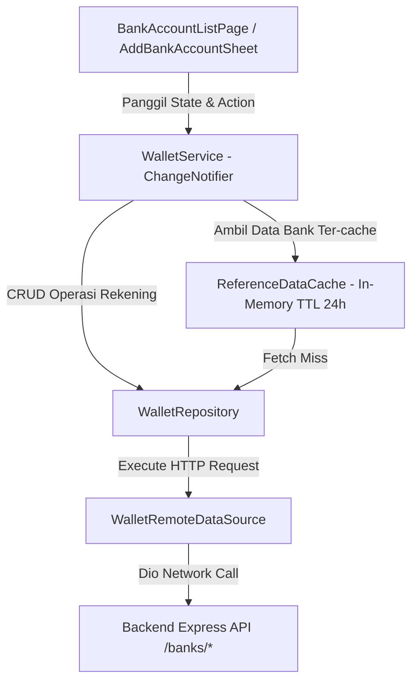

# Perencanaan Arsitektur & Integrasi API - Modul Rekening Bank (Customer & Mitra) v3

Dokumen ini mendefinisikan spesifikasi kontrak API (Backend DTO), audit kesenjangan (*gap analysis*), desain struktur data frontend, arsitektur *caching*, dan panduan integrasi modul Rekening Bank antara **Backend (Express + Prisma + Zod)** dan **Frontend Mobile (Flutter `travelindo`)**.

Acuan file backend: [`Backend/src/routes/banks.ts`](file:///d:/Retal-Apps/Backend/src/routes/banks.ts)  
File panduan eksekusi task: [`travelindo/docs/TASK_BANKS_V3.md`](file:///d:/Retal-Apps/travelindo/docs/TASK_BANKS_V3.md)

---

## 1. Ringkasan Eksekutif & Batasan Ruang Lingkup (Scope Boundaries)

Modul Rekening Bank (*Bank Accounts*) merupakan fondasi finansial penting bagi pengguna aplikasi Travelindo:
1. **Bagi Mitra (*Partner*)**: Digunakan sebagai rekening tujuan pencairan pendapatan (*mitra payout / earnings withdrawal*) dari hasil sewa kendaraan, paket tur, dan layanan travel.
2. **Bagi Pelanggan (*Customer*)**: Digunakan untuk penarikan saldo dompet (*wallet withdrawal*) dan pengembalian dana (*refund*) atas pembatalan pesanan (*booking cancellation*).

### Batasan Ruang Lingkup (Strict Isolation)
Sesuai arahan arsitektur, **route admin platform TIDAK diintegrasikan ke dalam Mobile Apps**:
- **DILUAR RUANG LINGKUP (EXCLUDED)**: Endpoint Admin (`/banks/admin/all`, `POST /banks/admin`, `PATCH /banks/admin/:id`, `DELETE /banks/admin/:id`). Endpoint ini khusus digunakan oleh Backoffice / Web CMS Admin untuk mengelola master data bank nasional.
- **DALAM RUANG LINGKUP (INCLUDED - MOBILE CLIENT)**: 5 endpoint operasional pengguna Customer & Mitra:
  1. `GET /banks/supported` (Publik / Referensi Bank Aktif yang Didukung Platform)
  2. `GET /banks/my-accounts` (User Terautentikasi - Daftar Rekening Bank Pribadi)
  3. `POST /banks/my-accounts` (User Terautentikasi - Tambah Rekening Bank Baru)
  4. `DELETE /banks/my-accounts/:id` (User Terautentikasi - Hapus Rekening Bank)
  5. `PATCH /banks/my-accounts/:id/primary` (User Terautentikasi - Jadikan Rekening Utama)

---

## 2. Audit Kesenjangan (Gap Analysis) Backend vs Frontend Saat Ini

Dari hasil inspeksi mendalam antara kode backend ([`Backend/src/routes/banks.ts`](file:///d:/Retal-Apps/Backend/src/routes/banks.ts), [`Backend/src/controllers/bank.controller.ts`](file:///d:/Retal-Apps/Backend/src/controllers/bank.controller.ts), [`Backend/src/services/user-bank.service.ts`](file:///d:/Retal-Apps/Backend/src/services/user-bank.service.ts), [`Backend/src/validations/bank.validation.ts`](file:///d:/Retal-Apps/Backend/src/validations/bank.validation.ts)) dan implementasi mobile saat ini di `travelindo` ([`wallet_model.dart`](file:///d:/Retal-Apps/travelindo/lib/features/wallet/data/models/wallet_model.dart), [`wallet_remote_datasource.dart`](file:///d:/Retal-Apps/travelindo/lib/features/wallet/data/wallet_remote_datasource.dart), [`wallet_service.dart`](file:///d:/Retal-Apps/travelindo/lib/features/wallet/application/wallet_service.dart), [`reference_data_cache.dart`](file:///d:/Retal-Apps/travelindo/lib/core/cache/reference_data_cache.dart), [`bank_account_list_page.dart`](file:///d:/Retal-Apps/travelindo/lib/features/wallet/presentation/pages/bank_account_list_page.dart)), ditemukan kesenjangan kritis berikut:

| No | Komponen / Alur | Kondisi Backend (`Backend/src/routes/banks.ts`) | Kondisi Frontend Saat Ini (`travelindo`) | Dampak / Risiko Fatal |
| :--- | :--- | :--- | :--- | :--- |
| **1** | **Field Nama Pemilik Rekening** | Format response backend: `accountName` (string, e.g. `"Budi Santoso"`). | `BankAccountModel` mem-parsing `accountHolder: json['accountHolder']`. | **Nama pemilik rekening SELALU KOSONG (`""`) di UI**. Tampilan rekening di daftar dan dropdown payout tidak memunculkan nama pemilik. |
| **2** | **Field Rekening Utama** | Format response backend: `isMain: boolean`. Backend mengurutkan `orderBy: { isMain: 'desc' }`. | `BankAccountModel` mem-parsing `isPrimary: json['isPrimary'] == true`. | **Status rekening utama SELALU FALSE**. Badge "Utama" tidak pernah muncul, dan tombol set bintang muncul di semua item. |
| **3** | **Kelengkapan Metadata Rekening** | Backend menyertakan: `id`, `userId`, `bankId`, `accountName`, `accountNumber`, `isMain`, `createdAt`, `bankName`, `bankCode`, `bankLogoUrl`. | `BankAccountModel` hanya menampung 4 field dasar (`id`, `bankName`, `accountNumber`, `accountHolder`, `isPrimary`). | Informasi vital seperti `bankId`, `bankCode`, dan `bankLogoUrl` terbuang, UI tidak bisa merender logo bank resmi. |
| **4** | **Payload Tambah Rekening (`POST /banks/my-accounts`)** | Skema Zod backend mewajibkan: `{ bankId: UUID, accountNumber: string(5-30), accountName: string(2-100), isMain?: boolean }`. | Form di `bank_account_list_page.dart` mengirim `{ bankName, bankCode, accountNumber, accountHolderName }`. Sama sekali **tidak mengirim `bankId`** dan field nama salah (`accountHolderName`). | **Request 100% GAGAL dengan error `400 Bad Request`** (`bankId: Required`, `accountName: Required`). User tidak dapat menambah rekening sama sekali. |
| **5** | **Ketiadaan Model Bertipe untuk Supported Bank** | `GET /banks/supported` mengembalikan array object bank: `{ id, code, name, logoUrl, isActive }`. | Frontend tidak memiliki model bertipe (`SupportedBankModel`), melainkan masih `List<Map<String, dynamic>>`. | Tidak *type-safe*, rentan null-pointer exception saat akses key map, dan autocompletion IDE tidak bekerja. |
| **6** | **Cache Data Referensi Bank** | Backend meng-cache daftar bank aktif di Redis selama 24 jam (`banks:active`). | `ReferenceDataCache.getBanks()` mengembalikan `List<Map<String, dynamic>>` alih-alih `List<SupportedBankModel>`. | Inkonsistensi arsitektur cache dengan modul lain seperti `AmenityModel` dan `PaymentChannelModel` yang sudah bertipe. |
| **7** | **Helper Endpoint URL di `ApiEndpoints`** | Endpoint delete backend adalah `DELETE /banks/my-accounts/:id`. | `ApiEndpoints` memiliki `bankAccounts` (`/banks/my-accounts`) dan `bankAccountPrimary(id)` (`/banks/my-accounts/:id/primary`), namun **tidak memiliki helper `bankAccountById(id)`**. `WalletRemoteDataSource` melakukan string interpolation manual `'${ApiEndpoints.bankAccounts}/$id'`. | Kurang rapi dan rawan typo jika endpoint path berubah di kemudian hari. |
| **8** | **UX Dialog vs Bottom Sheet Tambah Rekening** | Pengguna perlu memilih bank yang didukung dengan logo/ikon, input nomor rekening valid, nama pemilik, dan toggle jadikan utama. | Menggunakan `AlertDialog` sederhana dengan `TextField` manual nama bank jika list kosong, tanpa validasi panjang digit dan tanpa switch "Jadikan Utama". | Tampilan kaku, tidak modern, dan berpotensi input nama bank manual sembarangan yang ditolak backend. |
| **9** | **UX Konfirmasi Hapus Rekening** | Menghapus rekening adalah aksi destruktif (*destructive action*). | Menekan ikon tong sampah langsung mengeksekusi `deleteBankAccount` seketika tanpa dialog konfirmasi. | Pengguna dapat tidak sengaja menghapus rekening utama saat menyentuh layar HP. |
| **10** | **Feedback Operasi & Error Handling** | Backend mengembalikan pesan error deskriptif (misal: "Bank tidak ditemukan atau tidak aktif", "Rekening tidak ditemukan"). | `WalletService` menelan error di `catch (e) { return false; }` tanpa menyimpan `errorMessage` untuk ditampilkan ke pengguna via Snackbar/Toast. | Pengguna tidak tahu alasan kegagalan jika input ditolak backend. |

---

## 3. Spesifikasi Kontrak API Backend (Ground Truth)

Base URL: `{{AppEnv.apiV1BaseUrl}}` (misal: `http://10.0.2.2:3000/api/v1` untuk Android Emulator atau `http://localhost:3000/api/v1` untuk iOS Simulator).

Semua response backend dibungkus dalam format envelope standar:
```json
{
  "meta": {
    "success": true,
    "status": 200,
    "message": "Pesan deskriptif"
  },
  "data": ...
}
```

---

### 3.1. Daftar Bank yang Didukung Platform (Public / User Reference)

Mendapatkan daftar seluruh bank aktif yang didukung oleh sistem Travelindo. Data ini di-cache di Redis backend dengan TTL 24 jam (`banks:active`).

- **Endpoint**: `GET /banks/supported`
- **Auth**: Public / Optional Bearer Token
- **Headers**:
  ```http
  Accept: application/json
  ```
- **Response Success (`200 OK`)**:
  ```json
  {
    "meta": {
      "success": true,
      "status": 200,
      "message": "Daftar bank berhasil diambil"
    },
    "data": [
      {
        "id": "7c9b8b0e-6e82-4f32-8419-7ecb8f411b01",
        "code": "BCA",
        "name": "Bank Central Asia (BCA)",
        "logoUrl": "https://pub-r2.travelindo.com/banks/bca.png",
        "isActive": true
      },
      {
        "id": "18f45a1c-99c0-43b2-92f7-0487532dc122",
        "code": "BNI",
        "name": "Bank Negara Indonesia (BNI)",
        "logoUrl": "https://pub-r2.travelindo.com/banks/bni.png",
        "isActive": true
      },
      {
        "id": "e4a28f73-2d1b-4190-b981-6712399ecf33",
        "code": "BRI",
        "name": "Bank Rakyat Indonesia (BRI)",
        "logoUrl": "https://pub-r2.travelindo.com/banks/bri.png",
        "isActive": true
      },
      {
        "id": "a9310bb2-f3e4-4d29-a1b2-119284723044",
        "code": "MANDIRI",
        "name": "Bank Mandiri",
        "logoUrl": "https://pub-r2.travelindo.com/banks/mandiri.png",
        "isActive": true
      }
    ]
  }
  ```

---

### 3.2. Daftar Rekening Bank Saya (User Terautentikasi)

Mengambil daftar seluruh rekening bank yang didaftarkan oleh akun pengguna yang sedang login (Customer maupun Mitra). Nomor rekening didekripsi otomatis oleh backend sebelum dikirimkan ke client. Hasil selalu diurutkan dengan rekening utama di posisi pertama (`orderBy: { isMain: 'desc' }`).

- **Endpoint**: `GET /banks/my-accounts`
- **Auth**: Bearer Token (`requireAuth`)
- **Headers**:
  ```http
  Authorization: Bearer <JWT_ACCESS_TOKEN>
  Accept: application/json
  ```
- **Response Success (`200 OK`)**:
  ```json
  {
    "meta": {
      "success": true,
      "status": 200,
      "message": "Daftar rekening saya berhasil diambil"
    },
    "data": [
      {
        "id": "3fa85f64-5717-4562-b3fc-2c963f66afa6",
        "userId": "b3e944d1-8d2a-43c2-a9b0-98ff2a8e3211",
        "bankId": "7c9b8b0e-6e82-4f32-8419-7ecb8f411b01",
        "accountName": "Budi Santoso",
        "accountNumber": "1234567890",
        "isMain": true,
        "createdAt": "2026-09-20T10:15:30.000Z",
        "bankName": "Bank Central Asia (BCA)",
        "bankCode": "BCA",
        "bankLogoUrl": "https://pub-r2.travelindo.com/banks/bca.png"
      },
      {
        "id": "9cb15f22-1123-4562-b3fc-99882233aa11",
        "userId": "b3e944d1-8d2a-43c2-a9b0-98ff2a8e3211",
        "bankId": "a9310bb2-f3e4-4d29-a1b2-119284723044",
        "accountName": "Budi Santoso",
        "accountNumber": "9876543210123",
        "isMain": false,
        "createdAt": "2026-09-22T14:20:00.000Z",
        "bankName": "Bank Mandiri",
        "bankCode": "MANDIRI",
        "bankLogoUrl": "https://pub-r2.travelindo.com/banks/mandiri.png"
      }
    ]
  }
  ```

---

### 3.3. Tambah Rekening Bank Baru (User Terautentikasi)

Menambahkan rekening bank baru milik pengguna. Jika `isMain` bernilai `true`, backend secara otomatis mengatur seluruh rekening lain milik pengguna menjadi `isMain = false` dalam transaksi basis data (`prisma.$transaction`). Nomor rekening dienkripsi secara aman saat disimpan ke database.

- **Endpoint**: `POST /banks/my-accounts`
- **Auth**: Bearer Token (`requireAuth`)
- **Headers**:
  ```http
  Authorization: Bearer <JWT_ACCESS_TOKEN>
  Content-Type: application/json
  Accept: application/json
  ```
- **Validasi Zod Backend (`addBankAccountSchema`)**:
  - `bankId`: Wajib UUID valid (`z.string().uuid()`), merujuk ke tabel `Bank` aktif.
  - `accountNumber`: Wajib string minimal 5 karakter, maksimal 30 karakter (`z.string().min(5).max(30)`).
  - `accountName`: Wajib string minimal 2 karakter, maksimal 100 karakter (`z.string().min(2).max(100)`).
  - `isMain`: Opsional boolean (`z.boolean().optional()`).
- **Request Body (`application/json`)**:
  ```json
  {
    "bankId": "7c9b8b0e-6e82-4f32-8419-7ecb8f411b01",
    "accountNumber": "1234567890",
    "accountName": "Budi Santoso",
    "isMain": true
  }
  ```
- **Response Success (`201 Created`)**:
  ```json
  {
    "meta": {
      "success": true,
      "status": 201,
      "message": "Rekening berhasil ditambahkan"
    },
    "data": {
      "id": "3fa85f64-5717-4562-b3fc-2c963f66afa6",
      "userId": "b3e944d1-8d2a-43c2-a9b0-98ff2a8e3211",
      "bankId": "7c9b8b0e-6e82-4f32-8419-7ecb8f411b01",
      "accountName": "Budi Santoso",
      "accountNumber": "1234567890",
      "isMain": true,
      "createdAt": "2026-09-25T05:50:12.345Z",
      "bankName": "Bank Central Asia (BCA)",
      "bankCode": "BCA",
      "bankLogoUrl": "https://pub-r2.travelindo.com/banks/bca.png"
    }
  }
  ```
- **Kemungkinan Error**:
  - `400 Bad Request`: `ID bank tidak valid` / `Nomor rekening tidak valid` / `Nama pemilik rekening wajib diisi` / `Bank tidak ditemukan atau tidak aktif`.
  - `401 Unauthorized`: Token tidak valid atau kedaluwarsa.

---

### 3.4. Hapus Rekening Bank (User Terautentikasi)

Menghapus rekening bank milik pengguna berdasarkan ID rekening. Backend memverifikasi kepemilikan rekening (`where: { id: accountId, userId }`).

- **Endpoint**: `DELETE /banks/my-accounts/:id`
- **Auth**: Bearer Token (`requireAuth`)
- **Headers**:
  ```http
  Authorization: Bearer <JWT_ACCESS_TOKEN>
  Accept: application/json
  ```
- **URL Params**:
  - `id`: UUID ID rekening (`UserBankAccount.id`).
- **Response Success (`200 OK`)**:
  ```json
  {
    "meta": {
      "success": true,
      "status": 200,
      "message": "Rekening berhasil dihapus"
    },
    "data": null
  }
  ```
- **Kemungkinan Error**:
  - `400 Bad Request`: `ID rekening tidak valid` (jika bukan format UUID).
  - `404 Not Found`: `Rekening tidak ditemukan` (jika ID tidak ada atau milik user lain).

---

### 3.5. Jadikan Rekening Utama (User Terautentikasi)

Menyetel rekening tertentu sebagai rekening utama (`isMain = true`) dan secara atomik menonaktifkan status utama pada rekening lainnya.

- **Endpoint**: `PATCH /banks/my-accounts/:id/primary`
- **Auth**: Bearer Token (`requireAuth`)
- **Headers**:
  ```http
  Authorization: Bearer <JWT_ACCESS_TOKEN>
  Accept: application/json
  ```
- **URL Params**:
  - `id`: UUID ID rekening (`UserBankAccount.id`).
- **Response Success (`200 OK`)**:
  ```json
  {
    "meta": {
      "success": true,
      "status": 200,
      "message": "Rekening utama berhasil diperbarui"
    },
    "data": {
      "id": "9cb15f22-1123-4562-b3fc-99882233aa11",
      "userId": "b3e944d1-8d2a-43c2-a9b0-98ff2a8e3211",
      "bankId": "a9310bb2-f3e4-4d29-a1b2-119284723044",
      "accountName": "Budi Santoso",
      "accountNumber": "9876543210123",
      "isMain": true,
      "createdAt": "2026-09-22T14:20:00.000Z",
      "bankName": "Bank Mandiri",
      "bankCode": "MANDIRI",
      "bankLogoUrl": "https://pub-r2.travelindo.com/banks/mandiri.png"
    }
  }
  ```
- **Kemungkinan Error**:
  - `400 Bad Request`: `ID rekening tidak valid`.
  - `404 Not Found`: `Rekening tidak ditemukan`.

---

## 4. Desain DTO & Data Modeling Flutter

Untuk memastikan *strict type safety* dan sinkronisasi total dengan respons backend, dibuat model data terstruktur di `travelindo/lib/features/wallet/data/models/`:

### 4.1. `SupportedBankModel` (`supported_bank_model.dart`)
Model untuk menampung bank resmi yang didukung platform Travelindo:
```dart
class SupportedBankModel {
  const SupportedBankModel({
    required this.id,
    required this.code,
    required this.name,
    this.logoUrl,
    this.isActive = true,
  });

  final String id;
  final String code;
  final String name;
  final String? logoUrl;
  final bool isActive;

  factory SupportedBankModel.fromJson(Map<String, dynamic> json) {
    return SupportedBankModel(
      id: json['id']?.toString() ?? '',
      code: json['code']?.toString() ?? '',
      name: json['name']?.toString() ?? '',
      logoUrl: json['logoUrl']?.toString(),
      isActive: json['isActive'] != false,
    );
  }

  Map<String, dynamic> toJson() => {
    'id': id,
    'code': code,
    'name': name,
    if (logoUrl != null) 'logoUrl': logoUrl,
    'isActive': isActive,
  };
}
```

### 4.2. `BankAccountModel` (Pembaruan di `wallet_model.dart`)
Model rekening bank pengguna yang selaras dengan Prisma schema dan response DTO backend:
```dart
class BankAccountModel {
  const BankAccountModel({
    required this.id,
    required this.userId,
    required this.bankId,
    required this.accountName,
    required this.accountNumber,
    required this.isMain,
    required this.bankName,
    this.bankCode,
    this.bankLogoUrl,
    this.createdAt,
  });

  final String id;
  final String userId;
  final String bankId;
  final String accountName;
  final String accountNumber;
  final bool isMain;
  final String bankName;
  final String? bankCode;
  final String? bankLogoUrl;
  final String? createdAt;

  // Getter alias untuk backwards compatibility kode lama
  String get accountHolder => accountName;
  bool get isPrimary => isMain;

  factory BankAccountModel.fromJson(Map<String, dynamic> json) {
    return BankAccountModel(
      id: json['id']?.toString() ?? '',
      userId: json['userId']?.toString() ?? '',
      bankId: json['bankId']?.toString() ?? '',
      accountName: json['accountName']?.toString() ?? json['accountHolder']?.toString() ?? '',
      accountNumber: json['accountNumber']?.toString() ?? '',
      isMain: json['isMain'] == true || json['isPrimary'] == true,
      bankName: json['bankName']?.toString() ?? '',
      bankCode: json['bankCode']?.toString(),
      bankLogoUrl: json['bankLogoUrl']?.toString(),
      createdAt: json['createdAt']?.toString(),
    );
  }

  Map<String, dynamic> toJson() => {
    'id': id,
    'userId': userId,
    'bankId': bankId,
    'accountName': accountName,
    'accountNumber': accountNumber,
    'isMain': isMain,
    'bankName': bankName,
    if (bankCode != null) 'bankCode': bankCode,
    if (bankLogoUrl != null) 'bankLogoUrl': bankLogoUrl,
    if (createdAt != null) 'createdAt': createdAt,
  };
}
```

### 4.3. `AddBankAccountInput` DTO
Objek payload khusus saat menambah rekening untuk mencegah kesalahan pengiriman parameter:
```dart
class AddBankAccountInput {
  const AddBankAccountInput({
    required this.bankId,
    required this.accountNumber,
    required this.accountName,
    this.isMain = false,
  });

  final String bankId;
  final String accountNumber;
  final String accountName;
  final bool isMain;

  Map<String, dynamic> toJson() => {
    'bankId': bankId,
    'accountNumber': accountNumber.trim(),
    'accountName': accountName.trim(),
    'isMain': isMain,
  };
}
```

---

## 5. Arsitektur Layering Flutter (Clean Architecture)



### 5.1. Penyesuaian `ApiEndpoints` (`travelindo/lib/core/network/api_endpoints.dart`)
Tambahkan helper method untuk endpoint delete rekening:
```dart
static const String bankAccounts = '/banks/my-accounts';
static const String banksSupported = '/banks/supported';
static String bankAccountById(String id) => '/banks/my-accounts/$id';
static String bankAccountPrimary(String id) => '/banks/my-accounts/$id/primary';
```

### 5.2. Penyesuaian `ReferenceDataCache` (`travelindo/lib/core/cache/reference_data_cache.dart`)
Ubah return type `getBanks()` agar mengembalikan `Future<List<SupportedBankModel>>`:
```dart
Future<List<SupportedBankModel>> getBanks() {
  return _getOrFetch<List<SupportedBankModel>>(
    'banks',
    banksTtl,
    () async {
      final response = await _walletRepository.getSupportedBanks();
      return response.data ?? [];
    },
  );
}
```

### 5.3. Penyesuaian `WalletRemoteDataSource` & `WalletRepository`
- `getSupportedBanks()` mengembalikan `Future<ApiResponse<List<SupportedBankModel>>>`.
- `addBankAccount(AddBankAccountInput input)` menerima typed input DTO.
- `deleteBankAccount(String id)` menggunakan `ApiEndpoints.bankAccountById(id)`.
- `setPrimaryBankAccount(String id)` mengembalikan `Future<ApiResponse<BankAccountModel>>`.

### 5.4. Peningkatan `WalletService`
- Menyediakan status mutasi: `bool isSubmitting`, `bool isDeleting`.
- Menyediakan pesan error spesifik saat mutasi gagal (`_errorMessage = userFacingError(error)`).
- Penanganan cerdas: Jika daftar rekening masih kosong saat user menambah rekening baru, otomatis set `isMain = true`.
- Otomatis melakukan *reload* rekening saya setelah aksi `add`, `delete`, atau `setPrimary`.

---

## 6. Desain Antarmuka & Pengalaman Pengguna (UI/UX)

### 6.1. Halaman Daftar Rekening (`BankAccountListPage`)
1. **Header & Card List**:
   - Menampilkan logo bank jika `bank.bankLogoUrl` tersedia dengan `Image.network` + error fallback ke ikon `LucideIcons.landmark`.
   - Menampilkan badge "Utama" (*Teal badge*) yang elegan di samping nama bank jika `bank.isMain == true`.
   - Menampilkan nomor rekening dengan tipografi jelas dan baris pemilik "a.n. {accountName}".
2. **Action Jadikan Utama**:
   - Jika `!bank.isMain`, tampilkan tombol aksi "Jadikan Utama" (ikon bintang atau teks chip).
   - Memberikan konfirmasi visual seketika saat berhasil diperbarui.
3. **Action Hapus Rekening**:
   - Tombol hapus memunculkan `AlertDialog` / konfirmasi dialog terlebih dahulu: *"Hapus Rekening?" - "Apakah Anda yakin ingin menghapus rekening {bankName} - {accountNumber}?"*.
   - Mencegah *accidental click*.

### 6.2. Komponen Tambah Rekening (`AddBankAccountBottomSheet`)
Menggantikan dialog lama dengan Bottom Sheet modern (`showModalBottomSheet`):
1. **Dropdown / Selector Bank**:
   - Menampilkan daftar bank resmi dari `ReferenceDataCache.getBanks()`.
   - Menampilkan logo bank kecil dan nama bank resmi.
   - Menyimpan `bankId` yang terpilih.
2. **Field Nomor Rekening**:
   - `keyboardType: TextInputType.number`.
   - Validasi: Angka saja, minimal 5 digit, maksimal 30 digit.
3. **Field Nama Pemilik Rekening**:
   - `textCapitalization: TextCapitalization.words`.
   - Validasi: Minimal 2 karakter, maksimal 100 karakter.
   - Keterangan edukatif: *"Pastikan nama sama persis dengan yang tertera di buku tabungan/m-banking."*
4. **Switch Jadikan Utama**:
   - Toggle switch "Jadikan sebagai rekening utama".
   - Jika akun belum memiliki rekening lain, switch dalam posisi aktif (*default ON*).
5. **Tombol Simpan**:
   - Loading indicator pada tombol saat request `POST /banks/my-accounts` sedang berlangsung.

---

## 7. Matriks Error Handling & Validasi

| Kasus | HTTP Status | Pesan Backend | Respons UX Frontend Mobile |
| :--- | :--- | :--- | :--- |
| **Bank Tidak Aktif / Dihapus** | `400 Bad Request` | `"Bank tidak ditemukan atau tidak aktif"` | Tampilkan Snackbar error: *"Bank yang dipilih sedang tidak aktif. Silakan pilih bank lain."* |
| **Format Rekening Terlalu Pendek** | `400 Bad Request` | `"Nomor rekening tidak valid"` | Validasi di form Flutter sebelum kirim (min 5 digit). Jika lolos dan ditolak backend, munculkan pesan di bawah TextField. |
| **Nama Pemilik Kosong** | `400 Bad Request` | `"Nama pemilik rekening wajib diisi"` | Validasi di form Flutter (min 2 karakter). |
| **Hapus Rekening Tidak Ada** | `404 Not Found` | `"Rekening tidak ditemukan"` | Refresh daftar rekening otomatis dan beri tahu user: *"Rekening sudah tidak ditemukan."* |
| **Sesi Token Kedaluwarsa** | `401 Unauthorized` | `"Token tidak valid atau kedaluwarsa"` | Interceptor Dio menangani refresh token otomatis atau redirect ke `LoginPage`. |
| **Koneksi Terputus (Offline)** | `DioException` | Network Error | Tampilkan Banner/Snackbar: *"Gagal terhubung ke server. Periksa koneksi internet Anda."* |

---

## 8. Verifikasi & Checklist Acceptance Criteria

1. [ ] **Model Synchronization**: `BankAccountModel` membaca `accountName` dan `isMain` tanpa data hilang.
2. [ ] **SupportedBankModel**: Tersedia model strongly typed dan diintegrasikan ke `ReferenceDataCache`.
3. [ ] **Create Bank Account**: Form tambah rekening berhasil mengirimkan `bankId` (UUID) dan `accountName`, lolos validasi Zod backend.
4. [ ] **Primary Toggle**: Fitur jadikan rekening utama berhasil mengupdate status `isMain` secara atomik di UI dan server.
5. [ ] **Delete Protection**: Terdapat dialog konfirmasi sebelum menghapus rekening.
6. [ ] **Mitra Earnings Integration**: Penarikan pendapatan mitra (`MitraEarningsPage`) tetap kompatibel dan membaca rekening terbaru dengan mulus.
7. [ ] **Static Analysis**: Lolos `flutter analyze` tanpa warning atau error baru.
