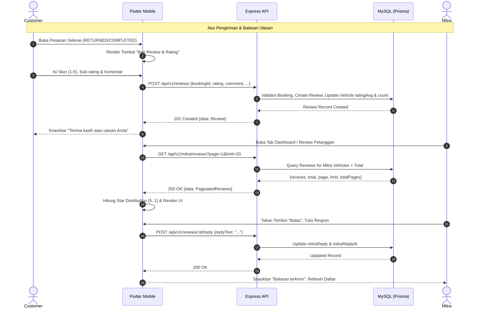

# Perencanaan Arsitektur & Integrasi API - Modul Ulasan / Reviews (Customer & Mitra) v1

Dokumen ini mendefinisikan spesifikasi kontrak API (Backend DTO), audit kesenjangan (*gap analysis*), desain struktur data frontend, arsitektur *state management*, serta panduan integrasi modul Ulasan (*Reviews & Ratings*) antara **Backend (Express + Prisma + Zod + MySQL)** dan **Frontend Mobile (Flutter `travelindo`)**.

Acuan file backend:
- Route: [`Backend/src/routes/reviews.ts`](file:///d:/Retal-Apps/Backend/src/routes/reviews.ts) & [`Backend/src/routes/mitra.ts`](file:///d:/Retal-Apps/Backend/src/routes/mitra.ts)
- Controller: [`Backend/src/controllers/review.controller.ts`](file:///d:/Retal-Apps/Backend/src/controllers/review.controller.ts) & [`Backend/src/controllers/mitra.controller.ts`](file:///d:/Retal-Apps/Backend/src/controllers/mitra.controller.ts)
- Service: [`Backend/src/services/review.service.ts`](file:///d:/Retal-Apps/Backend/src/services/review.service.ts) & [`Backend/src/services/mitra.service.ts`](file:///d:/Retal-Apps/Backend/src/services/mitra.service.ts)
- Validasi Zod: [`Backend/src/validations/review.validation.ts`](file:///d:/Retal-Apps/Backend/src/validations/review.validation.ts)
- Skema Prisma: Model `Review`, `Booking`, `Vehicle`, `User`, `MitraProfile`

File panduan eksekusi task: [`travelindo/docs/TASK_REVIEWS_V1.md`](file:///d:/Retal-Apps/travelindo/docs/TASK_REVIEWS_V1.md)

---

## 1. Ringkasan Eksekutif & Batasan Ruang Lingkup (Scope Boundaries)

Modul Ulasan (*Reviews*) adalah pilar reputasi dan transparansi ekosistem Travelindo yang berfungsi sebagai jembatan umpan balik antara Pelanggan (*Customer*) dan Pemilik Armada (*Mitra*):
1. **Bagi Pelanggan (*Customer Experience*)**:
   - Memberikan evaluasi berupa skor bintang (1–5) dan komentar teks setelah menyelesaikan masa sewa kendaraan.
   - Memberikan sub-rating penilaian (kebersihan, pelayanan, kondisi armada).
   - Membaca ulasan transparan dari pengguna lain pada halaman detail kendaraan publik dan profil mitra untuk memandu keputusan pemesanan.
   - Mengubah/memperbarui ulasan yang pernah dikirim (*edit review*).
2. **Bagi Mitra (*Partner Reputation Management*)**:
   - Memantau ringkasan performa ulasan (skor rata-rata, total ulasan, distribusi rating 1–5 bintang) di Dashboard Mitra.
   - Menelusuri seluruh riwayat ulasan kendaraan miliknya dengan paginasi.
   - Memberikan tanggapan/balasan resmi (*official reply*) terhadap ulasan pelanggan.

### Batasan Ruang Lingkup Integrasi Mobile Client

**DALAM RUANG LINGKUP (INCLUDED - MOBILE CLIENT)**:
1. `GET /api/v1/reviews/vehicle/:vehicleId` — Daftar review kendaraan publik + agregat (`averageRating`, `totalReviews`).
2. `GET /api/v1/reviews/mitra/:mitraId` — Daftar review seluruh armada milik suatu mitra (publik).
3. `POST /api/v1/reviews` — Pembuatan review baru oleh Customer setelah booking selesai.
4. `PATCH /api/v1/reviews/:id` — Pembaruan review oleh Customer yang bersangkutan.
5. `POST /api/v1/reviews/:id/reply` — Pengiriman balasan review resmi oleh Mitra pemilik kendaraan.
6. `GET /api/v1/mitra/reviews` — Daftar ulasan terpaginasi khusus untuk dashboard & manajemen ulasan Mitra terautentikasi.

**DILUAR RUANG LINGKUP (EXCLUDED - ADMIN ONLY)**:
- `DELETE /api/v1/reviews/:id` — Dikhususkan untuk Backoffice / CMS Web Admin guna moderasi konten ulasan spam/ilegal (`requireRole([UserRole.ADMIN])`).

---

## 2. Audit Kesenjangan (Gap Analysis) Backend vs Frontend Saat Ini

Investigasi menyeluruh pada implementasi backend dan kode frontend mobile Flutter (`travelindo`) menemukan **10 kesenjangan fatal & kritis**:

| No | Komponen / Area | Kondisi Backend | Kondisi Frontend Saat Ini | Dampak Fatal / Risiko Teknis |
| :--- | :--- | :--- | :--- | :--- |
| **1** | **Payload Mismatch Balasan Review Mitra** | Controller `replyToReview` membaca `const { replyText } = req.body;`. | `mitra_remote_datasource.dart` mengirim `data: {'reply': reply}`. | **FATAL**: Mitra mengirim balasan tetapi nilai `replyText` di backend selalu `undefined`. Balasan mitra **GAGAL TERSIMPAN** di database. |
| **2** | **Deserialisasi Response Review Mitra** | Endpoint `GET /api/v1/mitra/reviews` mengembalikan objek map `{ reviews: [...], total, page, limit, totalPages }`. | `mitra_remote_datasource.dart` mem-parse `(json) => json is List ? ... : []`. | **FATAL**: Pengecekan `json is List` selalu bernilai `false`. Daftar review Mitra **SELALU KOSONG (`[]`)**, halaman dan dashboard Mitra selalu berstatus kosong. |
| **3** | **Konflik Validasi Status Booking untuk Review** | `review.service.ts` memvalidasi ketat: `if (booking.status !== 'RETURNED') throw ...`. Status `COMPLETED` ditolak! | `booking_detail_page.dart` hanya menampilkan tombol "Beri Review & Rating" jika `booking.status == 'COMPLETED'`. | **FATAL**: Saat tombol review muncul di frontend (`COMPLETED`), backend menolak dengan error 400. Saat status `RETURNED`, frontend tidak menampilkan tombol sama sekali. Customer **TIDAK PERNAH BISA MEMBERI REVIEW**. |
| **4** | **Ketiadaan Data Distribusi Bintang Mitra** | `MitraReviewSummaryCard` membutuhkan map `distribution` (`'5'`, `'4'`, dst) untuk menampilkan bar visual persentase rating. | `MitraService.loadReviewsSummary()` hanya menghitung total dan rata-rata, **tidak pernah menghitung distribusi**. | Komponen progress bar rating 1–5 di kartu dashboard Mitra selalu 0% dan kosong melompong. |
| **5** | **Ketiadaan Model Bertipe untuk Mitra Reviews** | Backend mengirim metadata lengkap ulasan: `id, rating, comment, mitraReply, createdAt, vehicleBrand, vehicleModel, customerName, customerAvatarUrl`. | Mitra masih menggunakan `Map<String, dynamic>` mentah. Akses key ambigu (`review['mitraReply'] ?? review['reply']`). | Tidak *type-safe*, rawan null crash, dan tidak mendukung autocompletion IDE. |
| **6** | **Kehilangan Data Agregat pada Review Kendaraan Customer** | `GET /api/v1/reviews/vehicle/:vehicleId` mengembalikan `{ reviews: [...], averageRating: number, totalReviews: number }`. | `CustomerRemoteDataSource` hanya mengambil list review via `ReviewModel.listFromResponse`. | Nilai rating rata-rata dan total ulasan resmi dari database backend terbuang percuma di level remote datasource. |
| **7** | **Sub-Rating Terabaikan oleh Schema Zod** | Model Prisma `Review` dan service mendukung `ratingCleanliness`, `ratingService`, `ratingCondition`. | `submitReviewSchema` di backend Zod hanya mendefinisikan `bookingId`, `rating`, `comment`. Middleware `validate` memotong (*strip*) field lain. | Data sub-rating tidak pernah tersimpan ke database karena tereliminasi di middleware validasi. |
| **8** | **Fitur Edit Review Belum Terintegrasi di Mobile** | Backend menyediakan endpoint `PATCH /api/v1/reviews/:id`. | Frontend hanya punya definisi endpoint `ApiEndpoints.reviewById`, tanpa method di remote datasource, repository, service, maupun dialog UI edit. | Customer tidak dapat memperbaiki ulasan atau rating yang keliru dimasukkan. |
| **9** | **Ketiadaan Paginasi pada Halaman Review Mitra** | Backend mendukung parameter `page` dan `limit` pada `/mitra/reviews`. | Frontend `mitra_reviews_page.dart` hanya memanggil `loadReviewsSummary()` sekali tanpa mekanisme *pagination / load more*. | Jika mitra memiliki ratusan ulasan, ulasan halaman kedua ke atas tidak dapat diakses. |
| **10** | **Backend Kurang Validasi Skema untuk Reply & Edit** | `POST /:id/reply` tidak memiliki validasi Zod untuk `params.id` dan `body.replyText`. `PATCH /:id` hanya memvalidasi params tanpa validasi body `rating` (1–5). | Frontend rentan menerima error 500 alih-alih error 400 terformat jika data tidak lengkap. | Stabilitas API berkurang jika ada masukan string kosong atau rating di luar 1–5. |

---

## 3. Spesifikasi Kontrak API Backend (Ground Truth)

Base URL: `{{AppEnv.apiV1BaseUrl}}` (misal: `http://10.0.2.2:3000/api/v1` di Android Emulator).

Semua respons dibungkus dalam amplop standar:
```json
{
  "meta": {
    "success": true,
    "status": 200,
    "message": "Pesan deskriptif"
  },
  "data": ...
}
```

---

### 3.1. Ambil Ulasan Kendaraan Publik (`GET /reviews/vehicle/:vehicleId`)

Mengambil seluruh ulasan untuk sebuah armada kendaraan tertentu beserta statistik agregat rating.

- **Endpoint**: `GET /api/v1/reviews/vehicle/:vehicleId`
- **Auth**: Public / Opsional Bearer Token
- **Path Parameters**: `vehicleId` (UUID)
- **Response Success (`200 OK`)**:
```json
{
  "meta": {
    "success": true,
    "status": 200,
    "message": "Review kendaraan"
  },
  "data": {
    "reviews": [
      {
        "id": "7c9b8b0e-6e82-4f32-8419-7ecb8f411b01",
        "rating": 5,
        "comment": "Mobil sangat bersih, AC dingin, dan pemilik sangat ramah.",
        "mitraReply": "Terima kasih banyak atas kunjungannya kak! Ditunggu sewa berikutnya.",
        "createdAt": "2026-10-01T08:30:00.000Z",
        "customerName": "Budi Santoso",
        "customerAvatarUrl": "https://pub-r2.travelindo.com/users/avatars/budi.jpg"
      }
    ],
    "averageRating": 4.87,
    "totalReviews": 15
  }
}
```

---

### 3.2. Ambil Ulasan Publik Seluruh Armada Mitra (`GET /reviews/mitra/:mitraId`)

Mengambil ulasan publik dari seluruh kendaraan yang dimiliki oleh satu profil Mitra.

- **Endpoint**: `GET /api/v1/reviews/mitra/:mitraId`
- **Auth**: Public / Opsional Bearer Token
- **Path Parameters**: `mitraId` (UUID)
- **Response Success (`200 OK`)**:
```json
{
  "meta": {
    "success": true,
    "status": 200,
    "message": "Review mitra"
  },
  "data": [
    {
      "id": "7c9b8b0e-6e82-4f32-8419-7ecb8f411b01",
      "rating": 5,
      "comment": "Pelayanan rental sangat profesional dan tepat waktu.",
      "mitraReply": "Terima kasih atas kepercayaannya!",
      "createdAt": "2026-10-01T08:30:00.000Z",
      "vehicleBrand": "Toyota",
      "vehicleModel": "Innova Zenix 2023",
      "customerName": "Budi Santoso"
    }
  ]
}
```

---

### 3.3. Kirim Ulasan Booking Customer (`POST /reviews`)

Mengirimkan ulasan dan skor rating baru untuk transaksi rental kendaraan yang telah selesai.

- **Endpoint**: `POST /api/v1/reviews`
- **Auth**: Bearer Token (Role: `CUSTOMER`)
- **Headers**:
  ```http
  Authorization: Bearer <accessToken>
  Content-Type: application/json
  ```
- **Request Body**:
```json
{
  "bookingId": "8b9a1122-3344-5566-7788-99aabbccdde0",
  "rating": 5,
  "comment": "Mobil nyaman dan tarikannya mantap.",
  "ratingCleanliness": 5,
  "ratingService": 5,
  "ratingCondition": 4
}
```

- **Response Success (`201 Created`)**:
```json
{
  "meta": {
    "success": true,
    "status": 201,
    "message": "Review berhasil dikirim"
  },
  "data": {
    "id": "7c9b8b0e-6e82-4f32-8419-7ecb8f411b01",
    "bookingId": "8b9a1122-3344-5566-7788-99aabbccdde0",
    "vehicleId": "f47ac10b-58cc-4372-a567-0e02b2c3d479",
    "customerId": "3b2c1d0a-9876-5432-10fe-dcba98765432",
    "rating": 5,
    "comment": "Mobil nyaman dan tarikannya mantap.",
    "ratingCleanliness": 5,
    "ratingService": 5,
    "ratingCondition": 4,
    "createdAt": "2026-10-04T09:15:00.000Z"
  }
}
```

- **Respon Error Umum**:
  - `400 Bad Request`: `"Review hanya dapat diberikan setelah kendaraan dikembalikan"` (status booking belum `RETURNED` atau `COMPLETED`).
  - `400 Bad Request`: `"Anda sudah memberikan ulasan untuk booking ini"` (duplikasi ulasan).
  - `403 Forbidden`: `"Anda tidak berhak memberikan ulasan untuk booking ini"`.
  - `404 Not Found`: `"Booking tidak ditemukan"`.

---

### 3.4. Edit Ulasan Customer (`PATCH /reviews/:id`)

Memperbarui nilai rating atau komentar ulasan yang telah dibuat oleh Customer.

- **Endpoint**: `PATCH /api/v1/reviews/:id`
- **Auth**: Bearer Token (Role: `CUSTOMER`)
- **Path Parameters**: `id` (UUID ulasan)
- **Request Body**:
```json
{
  "rating": 4,
  "comment": "Mobil nyaman, namun AC sedikit kurang dingin di siang hari."
}
```

- **Response Success (`200 OK`)**:
```json
{
  "meta": {
    "success": true,
    "status": 200,
    "message": "Review berhasil diperbarui"
  },
  "data": {
    "id": "7c9b8b0e-6e82-4f32-8419-7ecb8f411b01",
    "vehicleId": "f47ac10b-58cc-4372-a567-0e02b2c3d479",
    "rating": 4,
    "comment": "Mobil nyaman, namun AC sedikit kurang dingin di siang hari.",
    "updatedAt": "2026-10-04T09:45:00.000Z"
  }
}
```

---

### 3.5. Balas Ulasan oleh Mitra (`POST /reviews/:id/reply`)

Memberikan respon resmi dari Mitra penyedia unit sewa atas ulasan yang diberikan pelanggan.

- **Endpoint**: `POST /api/v1/reviews/:id/reply`
- **Auth**: Bearer Token (Role: `MITRA`)
- **Path Parameters**: `id` (UUID ulasan)
- **Request Body**:
```json
{
  "replyText": "Terima kasih banyak atas masukannya kak. Kami akan segera servis unit AC-nya."
}
```

- **Response Success (`200 OK`)**:
```json
{
  "meta": {
    "success": true,
    "status": 200,
    "message": "Balasan berhasil dikirim"
  },
  "data": {
    "id": "7c9b8b0e-6e82-4f32-8419-7ecb8f411b01",
    "mitraReply": "Terima kasih banyak atas masukannya kak. Kami akan segera servis unit AC-nya.",
    "mitraReplyAt": "2026-10-04T10:00:00.000Z",
    "updatedAt": "2026-10-04T10:00:00.000Z"
  }
}
```

---

### 3.6. Daftar Ulasan Manajemen Mitra (`GET /mitra/reviews`)

Mengambil seluruh daftar ulasan untuk armada milik Mitra yang sedang login dengan paginasi.

- **Endpoint**: `GET /api/v1/mitra/reviews`
- **Auth**: Bearer Token (Role: `MITRA`)
- **Query Parameters**:
  - `page`: Nomor halaman (integer, default: 1)
  - `limit`: Jumlah per halaman (integer, default: 20)
- **Response Success (`200 OK`)**:
```json
{
  "meta": {
    "success": true,
    "status": 200,
    "message": "Review Mitra"
  },
  "data": {
    "reviews": [
      {
        "id": "7c9b8b0e-6e82-4f32-8419-7ecb8f411b01",
        "rating": 5,
        "comment": "Armada sangat terawat dan wangi.",
        "mitraReply": "Terima kasih banyak Pak Budi!",
        "createdAt": "2026-10-01T08:30:00.000Z",
        "vehicleBrand": "Toyota",
        "vehicleModel": "Avanza Veloz",
        "customerName": "Budi Santoso",
        "customerAvatarUrl": "https://pub-r2.travelindo.com/users/avatars/budi.jpg"
      }
    ],
    "total": 35,
    "page": 1,
    "limit": 20,
    "totalPages": 2
  }
}
```

---

## 4. Penyelarasan Backend Kritis (Backend Alignments)

Untuk menjamin integrasi 100% mulus dengan aplikasi Android Travelindo, tiga berkas backend perlu diselaraskan:

### 4.1. Pembaruan `Backend/src/services/review.service.ts`
1. **Dukungan Status Booking `RETURNED` & `COMPLETED`**:
   Ubah baris 45:
   ```typescript
   // Dari:
   if (booking.status !== 'RETURNED') throw new AppError('Review hanya dapat diberikan setelah kendaraan dikembalikan', 400);

   // Menjadi:
   const allowedStatuses = ['RETURNED', 'COMPLETED'];
   if (!booking.status || !allowedStatuses.includes(booking.status)) {
     throw new AppError('Review hanya dapat diberikan setelah kendaraan dikembalikan atau pesanan selesai', 400);
   }
   ```
2. **Kueri Customer Avatar di `getMitraReviews`**:
   Tambahkan `customer.avatarUrl` pada `getMitraReviews` agar ulasan profil mitra publik juga menampilkan foto profil pengulas.

### 4.2. Pembaruan `Backend/src/validations/review.validation.ts`
1. Tambahkan sub-rating opsional pada `submitReviewSchema`:
   ```typescript
   export const submitReviewSchema = z.object({
     body: z.object({
       bookingId: z.string().uuid('ID booking tidak valid'),
       rating: z.number().int().min(1).max(5, 'Rating antara 1–5'),
       comment: z.string().optional(),
       ratingCleanliness: z.number().int().min(1).max(5).optional(),
       ratingService: z.number().int().min(1).max(5).optional(),
       ratingCondition: z.number().int().min(1).max(5).optional(),
     }),
   });
   ```
2. Tambahkan skema validasi balasan review (`replyReviewSchema`):
   ```typescript
   export const replyReviewSchema = z.object({
     params: z.object({ id: z.string().uuid('ID review tidak valid') }),
     body: z.object({
       replyText: z.string().min(1, 'Balasan ulasan tidak boleh kosong'),
     }),
   });
   ```
3. Tambahkan skema validasi edit review (`editReviewSchema`):
   ```typescript
   export const editReviewSchema = z.object({
     params: z.object({ id: z.string().uuid('ID review tidak valid') }),
     body: z.object({
       rating: z.number().int().min(1).max(5).optional(),
       comment: z.string().optional(),
     }),
   });
   ```

### 4.3. Pembaruan `Backend/src/routes/reviews.ts`
Pasangkan middleware validasi pada route `reply`:
```typescript
router.post(
  '/:id/reply',
  requireAuth,
  requireRole([UserRole.MITRA]),
  validate(v.replyReviewSchema),
  reviewController.replyToReview,
);

router.patch(
  '/:id',
  requireAuth,
  requireRole([UserRole.CUSTOMER]),
  validate(v.editReviewSchema),
  reviewController.editReview,
);
```

---

## 5. Arsitektur Data Layer Frontend Mobile (Flutter)

### 5.1. Model DTO Terpadu
1. **`VehicleReviewAggregateModel`**:
   Menampung daftar review kendaraan beserta skor agregat (`averageRating`, `totalReviews`).
2. **`MitraReviewItemModel`**:
   Model bertipe kuat untuk item ulasan mitra dengan konversi tanggal aman dan helper nama/brand.
3. **`MitraReviewPaginatedModel`**:
   Menampung respons paginasi `GET /api/v1/mitra/reviews` (`reviews`, `total`, `page`, `limit`, `totalPages`).
4. **`ReviewInputDto`**:
   Input payload pengiriman review dengan dukungan sub-rating.

### 5.2. Kalkulasi Distribusi Bintang di `MitraService`
Hitung sebaran bintang dari koleksi ulasan agar `MitraReviewSummaryCard` menampilkan diagram batang persentase rating secara akurat:
```dart
Map<String, int> calculateStarDistribution(List<MitraReviewItemModel> reviews) {
  final dist = {'5': 0, '4': 0, '3': 0, '2': 0, '1': 0};
  for (final r in reviews) {
    final key = r.rating.clamp(1, 5).toString();
    dist[key] = (dist[key] ?? 0) + 1;
  }
  return dist;
}
```

---

## 6. Diagram Alur & State Machine



---

## 7. Definition of Done (DoD)

1. [ ] Backend mengizinkan ulasan untuk booking berstatus `RETURNED` dan `COMPLETED`.
2. [ ] Backend Zod schema memvalidasi `replyText` dan mengizinkan `ratingCleanliness`, `ratingService`, `ratingCondition`.
3. [ ] `MitraRemoteDataSource.replyReview` mengirim kunci `replyText` (bukan `reply`).
4. [ ] `MitraRemoteDataSource.getMitraReviews` berhasil mengurai objek paginasi tanpa list kosong.
5. [ ] `MitraReviewSummaryCard` menampilkan distribusi bar 1–5 bintang yang sesuai fakta ulasan.
6. [ ] `BookingDetailPage` menampilkan tombol review untuk status `RETURNED` dan `COMPLETED`.
7. [ ] Terdapat opsi edit ulasan bagi Customer (`PATCH /reviews/:id`).
8. [ ] Static analysis Dart (`flutter analyze`) dan TypeScript Backend (`npm run build`) lulus tanpa error.
