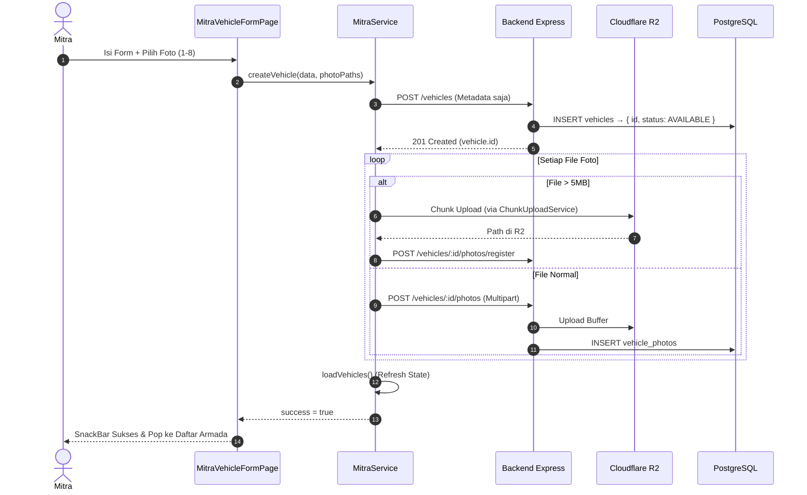
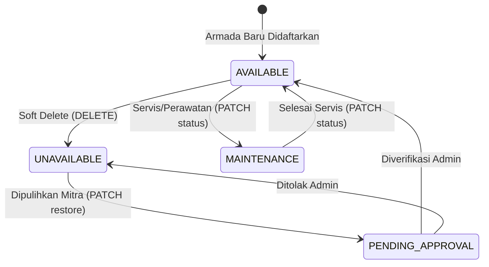

# Perencanaan Arsitektur & Integrasi API - Modul Kendaraan / Armada (Customer & Mitra) v1

Dokumen ini mendefinisikan spesifikasi kontrak API (Backend DTO), audit kesenjangan (*gap analysis*), desain struktur data frontend, arsitektur *state machine* status armada, serta panduan integrasi modul Kendaraan (*Vehicles & Fleet Management*) antara **Backend (Express + Prisma + Zod + Cloudflare R2)** dan **Frontend Mobile (Flutter `travelindo`)**.

Acuan file backend:
- Validasi Zod: [`Backend/src/validations/vehicle.validation.ts`](file:///d:/Retal-Apps/Backend/src/validations/vehicle.validation.ts)
- Route: [`Backend/src/routes/vehicles.ts`](file:///d:/Retal-Apps/Backend/src/routes/vehicles.ts)
- Controller: [`Backend/src/controllers/vehicle.controller.ts`](file:///d:/Retal-Apps/Backend/src/controllers/vehicle.controller.ts)
- Service Core Kendaraan: [`Backend/src/services/vehicle.service.ts`](file:///d:/Retal-Apps/Backend/src/services/vehicle.service.ts)
- Skema Prisma: [`Backend/prisma/schema.prisma`](file:///d:/Retal-Apps/Backend/prisma/schema.prisma) *(Model `Vehicle`, `VehiclePhoto`, `VehicleBlockedDate`, `MitraProfile`)*

File panduan eksekusi task: [`travelindo/docs/TASK_VEHICLES_V1.md`](file:///d:/Retal-Apps/travelindo/docs/TASK_VEHICLES_V1.md)

---

## 1. Ringkasan Eksekutif & Batasan Ruang Lingkup (Scope Boundaries)

Modul Kendaraan (*Vehicles*) adalah inti operasional bisnis Travelindo yang menghubungkan penawaran armada dari penyedia jasa (Mitra) dengan kebutuhan mobilitas pengguna akhir (Customer). Modul ini terbagi ke dalam dua domain fungsional:

1. **Domain Pelanggan (*Customer Experience*)**:
   - **Katalog & Eksplorasi Armada**: Pencarian dan penyaringan armada multi-kriteria (tipe, transmisi, rentang harga, rating, fasilitas, layanan sopir, pemesanan instan, dan tipe sewa).
   - **Pencarian Berbasis Lokasi (*Geo-location Sorting*)**: Pengurutan armada terdekat (`distance_asc`), terdekat dan termurah (`nearest_cheapest`), atau terdekat dengan rating tertinggi (`nearest_top_rated`) berbasis radius koordinat GPS (Haversine).
   - **Ketersediaan Unit (*Availability Check*)**: Pengecekan kalender tanggal armada tidak dapat disewa (karena pemesanan aktif atau pemblokiran manual oleh mitra).
   - **Koleksi Favorit (*Wishlist / Social*)**: Kemampuan menandai armada sebagai favorit secara sinkron dengan akun pengguna.

2. **Domain Mitra (*Fleet Management*)**:
   - **Pendaftaran & Metadata Armada**: Menambahkan unit kendaraan baru dengan validasi ketat (nama, merek, model, tipe kendaraan, tahun, transmisi, plat nomor, warna, kapasitas penumpang, harga harian, tipe sewa, harga dengan sopir, harga all-in, dan deposit).
   - **Unggah Foto Bertingkat (*Anti-Timeout Multi-step Upload*)**: Kompresi lokal, *chunk upload* R2 atau *multipart upload*, serta penetapan foto utama (*primary photo*).
   - **Pengaturan Tarif Tambahan (*Dynamic Pricing*)**: Penyesuaian fleksibel tarif sopir, paket komplit, dan uang jaminan (*security deposit*).
   - **Manajemen Ketersediaan & Jadwal Blocked Dates**: Memblokir tanggal-tanggal tertentu dengan keterangan alasan.
   - **Siklus Hidup Status Armada**: Mengelola transisi unit: `AVAILABLE`, `UNAVAILABLE`, `MAINTENANCE`, `PENDING_APPROVAL`.

### Batasan Ruang Lingkup Integrasi Mobile Client

**DALAM RUANG LINGKUP (INCLUDED - MOBILE CLIENT)**:
1. `GET /api/v1/vehicles` — Daftar kendaraan publik dengan filter lengkap & geo-sort.
2. `GET /api/v1/vehicles/:id` — Detail komprehensif kendaraan, seluruh foto galeri, pemilik mitra.
3. `GET /api/v1/vehicles/:id/availability` — Daftar tanggal pemblokiran unit untuk kalender.
4. `POST /api/v1/vehicles/:id/favorite` — Toggle status favorit customer.
5. `GET /api/v1/vehicles/favorites` — Daftar kendaraan favorit pengguna.
6. `GET /api/v1/vehicles/mitra/vehicles` — Daftar armada milik mitra dengan filter & paginasi.
7. `POST /api/v1/vehicles` — Tambah metadata kendaraan baru oleh Mitra.
8. `PUT /api/v1/vehicles/:id` — Perbarui metadata kendaraan oleh Mitra.
9. `DELETE /api/v1/vehicles/:id` — Hapus/nonaktifkan kendaraan (soft-delete).
10. `PATCH /api/v1/vehicles/:id/status` — Ubah status operasional unit.
11. `PATCH /api/v1/vehicles/:id/restore` — Pulihkan unit nonaktif ke `PENDING_APPROVAL`.
12. `POST /api/v1/vehicles/:id/photos` & `POST /api/v1/vehicles/:id/photos/register` — Unggah dan daftarkan foto.
13. `DELETE /api/v1/vehicles/:id/photos/:photoId` — Hapus foto spesifik.
14. `POST /api/v1/vehicles/:id/pricing` — Atur skema harga khusus (`setPricingSchema`).
15. `PUT /api/v1/vehicles/:id/blocked-dates` — Atur tanggal tidak tersedia (`setAvailabilitySchema`).

**DILUAR RUANG LINGKUP (EXCLUDED)**:
- Pelacakan GPS real-time & Geofence (`/mitra/vehicles/:id/location`, `/geofence`) — dikelola di modul Mitra Pro.
- Alur kalkulasi sewa dan checkout (`/bookings`) — dikelola di modul Bookings.

---

## 2. Audit Kesenjangan (Gap Analysis) Backend vs Frontend Saat Ini

Investigasi mendalam pada [`vehicle.validation.ts`](file:///d:/Retal-Apps/Backend/src/validations/vehicle.validation.ts), [`vehicle.controller.ts`](file:///d:/Retal-Apps/Backend/src/controllers/vehicle.controller.ts), [`vehicle.service.ts`](file:///d:/Retal-Apps/Backend/src/services/vehicle.service.ts), dan kode Flutter menemukan **10 kesenjangan fatal**:

| No | Komponen / Area | Kondisi Backend | Kondisi Frontend Saat Ini | Dampak Fatal / Risiko Teknis |
| :--- | :--- | :--- | :--- | :--- |
| **1** | **Enum Status Kendaraan — Mismatch Fatal** | Prisma enum: `AVAILABLE`, `UNAVAILABLE`, `MAINTENANCE`, `PENDING_APPROVAL`. Controller memvalidasi ketat 4 nilai ini (error 400 jika salah). | `MitraVehiclesPage` mengirim `'ACTIVE'` dan `'INACTIVE'` ke endpoint status. Badge mengecek `vehicle.status == 'ACTIVE'`. | **FATAL**: Switch toggle status kendaraan di Mitra **SELALU GAGAL (Error 400 Bad Request)**. Badge selalu abu-abu/nonaktif meski unit aktif. |
| **2** | **Parsing Tanggal Ketersediaan Unit** | Backend mengembalikan list objek: `[{ blockedDate: "2026-10-05T00:00:00.000Z", reason: "..." }]`. | `getVehicleAvailability` melakukan `(json as List).map((e) => e.toString())` — menghasilkan representasi Map mentah bukan string tanggal. | **BUG KALENDER**: Perbandingan tanggal di `_CalendarGrid` tidak pernah cocok. Tanggal blocked tidak pernah muncul di kalender customer. |
| **3** | **Atribut Model Kendaraan Customer Tidak Lengkap** | Detail endpoint mengembalikan: `year`, `licensePlate`, `color`, `seatingCapacity`, `priceWithDriver`, `priceFullPackage`, `depositAmount`, `rentalType`, `status`, `fuelType`, `amenities`, dan seluruh array `photos`. | `VehicleModel` hanya punya field dasar nama, brand, model, type, pricePerDay, ratingAvg, photos (1 foto), deskripsi. | Kapasitas penumpang, warna, tahun, opsi sopir, paket all-in tidak tampil di halaman detail customer. Galeri foto hanya 1 gambar. |
| **4** | **Parameter Query Filter Pencarian Customer** | `getVehiclesSchema` mendukung: `brand`, `isInstantBooking`, `rentalType`, `dateStart`, `dateEnd`, `withDriver`, `regencyId`. | `CustomerRepository.getVehicles` tidak menyediakan parameter `brand`, `isInstantBooking`, `rentalType`, `dateStart`, `dateEnd`, `withDriver`, `regencyId`. | Pelanggan tidak bisa filter armada tersedia pada rentang tanggal sewa, tidak bisa filter berdasar layanan sopir, maupun kabupaten/kota. |
| **5** | **Field Form Penambahan Armada Mitra** | `createVehicleSchema` mewajibkan semua field dasar dan menerima opsional: `rentalType`, `isInstantBooking`, `priceWithDriver`, `priceFullPackage`, `depositAmount`. | `MitraVehicleFormPage._submit()` hanya mengirim 8 field dasar tanpa `rentalType`, `isInstantBooking`, `priceWithDriver`, `priceFullPackage`, `depositAmount`. | Mitra tidak bisa aktifkan Instant Booking atau set jenis shuttle dari form utama. Harga sopir/deposit harus dibuka di halaman terpisah setelah armada terbuat. |
| **6** | **Paginasi & Filter Armada Mitra** | Backend mengembalikan `paginatedResponse` dan mendukung query params `status`, `type`, `search`, `page`, `limit`. | `getVehicles()` dipanggil tanpa query params. Response di-parse sebagai `ApiResponse<List<MitraVehicleModel>>` bukan `PaginatedResponse`. | Jika armada > 10, data ke-11 dst tidak pernah diambil. Tidak ada search/filter di dashboard mitra. |
| **7** | **Inkonsistensi Field Kapasitas** | Prisma dan Zod menggunakan `seatingCapacity` (integer positif). | `MitraVehicleModel` memiliki `@Default(0) int capacity` **dan** `int? seatingCapacity` secara bersamaan. | Data binding ambigu; nilai kapasitas sering tampil `0` di ringkasan armada mitra. |
| **8** | **Ketiadaan Fitur Pulihkan Armada** | Backend menyediakan `PATCH /vehicles/:id/restore` untuk `UNAVAILABLE` → `PENDING_APPROVAL`. | Tidak ada method `restoreVehicle` di `MitraRemoteDataSource`, `MitraRepository`, maupun `MitraService`. | Mitra tidak bisa memulihkan armada yang tidak sengaja dihapus/dinonaktifkan. |
| **9** | **Field Alasan Pemblokiran Tanggal** | `setAvailabilitySchema.body` menerima `{ blockedDates: string[], reason?: string }`. | `mitra_vehicle_blocked_dates_page` hanya mengirim list tanggal tanpa field `reason`. | Riwayat jadwal blocked tidak memiliki konteks keterangan di database (misal: "Servis AC" tidak tersimpan). |
| **10** | **Galeri Foto Detail Kendaraan Customer Terpotong** | Backend mengirim seluruh array `photos: [{ id, photoUrl, isPrimary, caption }]`. | `VehicleDetailPage._galleryUrls` hanya mengambil `vehicle.primaryPhotoUrl` sebagai 1 item: `[primaryPhotoUrl]`. | Tampilan galeri foto mobil hanya 1 foto meskipun mitra mengunggah 8 foto dari berbagai sudut. |

---

## 3. Spesifikasi Kontrak API Backend (Ground Truth)

Base URL: `{{AppEnv.apiV1BaseUrl}}` (contoh: `http://10.0.2.2:3000/api/v1` di Android Emulator).

Format amplop standar:
```json
{ "meta": { "success": true, "status": 200, "message": "..." }, "data": ... }
```
Format terpaginasi:
```json
{ "meta": { ..., "pagination": { "page": 1, "limit": 10, "total": 45, "totalPages": 5 } }, "data": [...] }
```

---

### 3.1. Ambil Daftar Kendaraan Publik (`GET /vehicles`)

- **Auth**: Public (opsional Bearer Token)
- **Query Parameters** (`getVehiclesSchema`):

| Parameter | Tipe | Keterangan |
| :--- | :--- | :--- |
| `type` | String | `CAR`, `MOTORBIKE`, `VAN`, `BUS`, `TRUCK` |
| `brand` | String | Filter nama merek (misal: "Toyota") |
| `transmission` | String | `MANUAL`, `MATIC` |
| `minPrice` / `maxPrice` | Number | Filter rentang harga harian |
| `minRating` | Number | Rating minimal (misal: 4.0) |
| `isInstantBooking` | `'true'`/`'false'` | Filter instant booking |
| `rentalType` | String | `RENTAL`, `SHUTTLE`, `BOTH` |
| `amenityIds` | String | ID fasilitas, dipisah koma (`id1,id2`) |
| `dateStart` / `dateEnd` | String | Format `YYYY-MM-DD` (filter rentang tanggal sewa) |
| `search` | String | Cari nama, merek, atau model |
| `withDriver` | `'true'`/`'false'` | Ada/tidaknya harga sopir |
| `sort` | String | `price_asc`, `price_desc`, `rating`, `newest`, `distance_asc`, `nearest_cheapest`, `nearest_top_rated` |
| `lat` / `lng` | Number | Koordinat user untuk geo-sort |
| `radiusKm` | Number | Radius filter jarak (default: 25 km) |
| `regencyId` | UUID | Filter berdasarkan kabupaten/kota mitra |
| `page` / `limit` | Number | Paginasi (default: 1/10) |

- **Response `200 OK` (item di `data[]`)**:
```json
{
  "id": "7c9e6679-7425-40de-944b-e07fc1f90ae7",
  "name": "Toyota Avanza Veloz 2023",
  "brand": "Toyota",
  "model": "Avanza Veloz",
  "type": "CAR",
  "transmission": "MATIC",
  "pricePerDay": 350000.0,
  "ratingAvg": 4.8,
  "reviewCount": 24,
  "isInstantBooking": true,
  "distanceKm": 3.42,
  "photos": [{ "photoUrl": "https://...", "isPrimary": true }],
  "mitra": {
    "id": "...", "storeName": "Berkah Rental", "isVerified": true,
    "ownerName": "Budi", "phoneNumber": "081234", "avatarUrl": "https://...",
    "latitude": -6.2088, "longitude": 106.8456,
    "address": "Jl. Sudirman No.45, Jakarta Selatan", "regencyId": "..."
  }
}
```

---

### 3.2. Detail Kendaraan Lengkap (`GET /vehicles/:id`)

- **Auth**: Public (opsional Bearer Token untuk deteksi `isFavorited`)
- **Response `200 OK`** (`data` object):
```json
{
  "id": "7c9e6679...", "mitraId": "f47ac10b...",
  "name": "Toyota Avanza Veloz 2023",
  "brand": "Toyota", "model": "Avanza Veloz", "year": 2023,
  "licensePlate": "B 1234 ABC", "color": "Putih Mutiara",
  "transmission": "MATIC", "fuelType": "PETROL",
  "seatingCapacity": 7,
  "pricePerDay": 350000.0,
  "priceWithDriver": 500000.0,
  "priceFullPackage": 700000.0,
  "depositAmount": 200000.0,
  "status": "AVAILABLE",
  "type": "CAR",
  "rentalType": "RENTAL",
  "description": "AC dingin, kondisi terawat.",
  "seatMap": null,
  "isInstantBooking": true,
  "ratingAvg": 4.85,
  "reviewCount": 24,
  "isFavorited": false,
  "photos": [
    { "id": "e2a1b940...", "photoUrl": "https://...", "isPrimary": true, "caption": "Tampak Depan" },
    { "id": "b3c2d1e0...", "photoUrl": "https://...", "isPrimary": false, "caption": "Interior" }
  ],
  "mitra": {
    "id": "...", "storeName": "Berkah Rental", "isVerified": true, "rating": 4.9,
    "ownerName": "Budi Santoso", "phoneNumber": "08123456789", "avatarUrl": "https://...",
    "latitude": -6.2088, "longitude": 106.8456,
    "address": "Jl. Sudirman No. 45, Jakarta Selatan", "regencyId": "..."
  }
}
```

---

### 3.3. Kalender Ketersediaan Unit (`GET /vehicles/:id/availability`)

- **Auth**: Public
- **Response `200 OK`**:
```json
{
  "data": [
    { "blockedDate": "2026-10-05T00:00:00.000Z", "reason": "Servis Berkala" },
    { "blockedDate": "2026-10-06T00:00:00.000Z", "reason": "Servis Berkala" }
  ]
}
```

---

### 3.4. Tambah Kendaraan Baru (`POST /vehicles`)

- **Auth**: Bearer Token (`MITRA` only)
- **Request Body** (`createVehicleSchema`):
```json
{
  "name": "Honda HR-V SE 2024",
  "brand": "Honda",
  "model": "HR-V SE",
  "type": "CAR",
  "year": 2024,
  "transmission": "MATIC",
  "licensePlate": "B 8888 HR",
  "color": "Meteoroid Gray",
  "seatingCapacity": 5,
  "pricePerDay": 650000,
  "rentalType": "RENTAL",
  "isInstantBooking": true,
  "priceWithDriver": 850000,
  "priceFullPackage": 1100000,
  "depositAmount": 300000,
  "description": "Kondisi prima, panoramic sunroof."
}
```
- **Response `201 Created`**: Objek kendaraan yang baru dibuat.
- **Kemungkinan Error**:
  - `400`: Validasi Zod gagal (brand.min(2), licensePlate.min(3), dll.)
  - `403`: Batas kuota armada FREE tier tercapai.

---

### 3.5. Perbarui Kendaraan (`PUT /vehicles/:id`)

- **Auth**: Bearer Token (`MITRA` only, harus pemilik)
- **Request Body** (`updateVehicleSchema`): Semua field opsional, kirim hanya yang berubah.
- **Response `200 OK`**: Objek kendaraan yang diperbarui.

---

### 3.6. Ubah Status Kendaraan (`PATCH /vehicles/:id/status`)

- **Auth**: Bearer Token (`MITRA` only)
- **Request Body**:
```json
{ "status": "AVAILABLE" }
```
> **KRITIS**: Nilai `status` yang diizinkan: `'AVAILABLE'`, `'UNAVAILABLE'`, `'MAINTENANCE'`, `'PENDING_APPROVAL'`. Nilai lain menghasilkan **400 Bad Request**.
- **Response `200 OK`**: `{ id, status, updatedAt }`

---

### 3.7. Pulihkan Kendaraan Nonaktif (`PATCH /vehicles/:id/restore`)

- **Auth**: Bearer Token (`MITRA` only)
- **Fungsi**: `UNAVAILABLE` → `PENDING_APPROVAL`
- **Response `200 OK`**: `{ id, status: "PENDING_APPROVAL", updatedAt }`

---

### 3.8. Atur Harga Khusus (`POST /vehicles/:id/pricing`)

- **Auth**: Bearer Token (`MITRA` only)
- **Request Body** (`setPricingSchema`, minimal 1 field):
```json
{
  "pricePerDay": 350000,
  "priceWithDriver": 500000,
  "priceFullPackage": 700000,
  "depositAmount": 200000
}
```

---

### 3.9. Atur Tanggal Tidak Tersedia (`PUT /vehicles/:id/blocked-dates`)

- **Auth**: Bearer Token (`MITRA` only)
- **Request Body** (`setAvailabilitySchema`):
```json
{
  "blockedDates": ["2026-10-10", "2026-10-11", "2026-10-12"],
  "reason": "Perawatan AC dan Ganti Ban"
}
```

---

### 3.10. Armada Milik Mitra (`GET /vehicles/mitra/vehicles`)

- **Auth**: Bearer Token (`MITRA` only)
- **Query Params** (`getMitraVehiclesSchema`): `status`, `type`, `search`, `page` (default 1), `limit` (default 10).
- **Response**: `PaginatedResponse<MitraVehicleModel>` dengan field lengkap armada termasuk `priceWithDriver`, `priceFullPackage`, `depositAmount`, `rentalType`, `isInstantBooking`, `primaryPhotoUrl`, `amenities`, `blockedDates`.

---

## 4. Desain Arsitektur & Flutter DTO

### 4.1. Enum Bertipe Kuat (Mengganti Perbandingan String Mentah)

File baru: [`travelindo/lib/features/mitra/data/models/vehicle_enums.dart`](file:///d:/Retal-Apps/travelindo/lib/features/mitra/data/models/vehicle_enums.dart)

```dart
// === VehicleStatusEnum ===
enum VehicleStatusEnum {
  available('AVAILABLE', 'Aktif & Tersedia'),
  unavailable('UNAVAILABLE', 'Nonaktif'),
  maintenance('MAINTENANCE', 'Dalam Perawatan'),
  pendingApproval('PENDING_APPROVAL', 'Menunggu Verifikasi');

  const VehicleStatusEnum(this.value, this.label);
  final String value;
  final String label;

  bool get isOperational => this == VehicleStatusEnum.available;

  static VehicleStatusEnum fromString(String? val) =>
    VehicleStatusEnum.values.firstWhere(
      (e) => e.value == val,
      orElse: () => VehicleStatusEnum.unavailable,
    );
}

// === VehicleTypeEnum ===
enum VehicleTypeEnum {
  car('CAR', 'Mobil'),
  motorbike('MOTORBIKE', 'Motor'),
  van('VAN', 'Minivan'),
  bus('BUS', 'Bus'),
  truck('TRUCK', 'Truk');

  const VehicleTypeEnum(this.value, this.label);
  final String value;
  final String label;

  static VehicleTypeEnum fromString(String? val) =>
    VehicleTypeEnum.values.firstWhere(
      (e) => e.value == val,
      orElse: () => VehicleTypeEnum.car,
    );
}

// === TransmissionTypeEnum ===
enum TransmissionTypeEnum {
  matic('MATIC', 'Otomatis / Matic'),
  manual('MANUAL', 'Manual');

  const TransmissionTypeEnum(this.value, this.label);
  final String value;
  final String label;

  static TransmissionTypeEnum fromString(String? val) =>
    TransmissionTypeEnum.values.firstWhere(
      (e) => e.value == val,
      orElse: () => TransmissionTypeEnum.matic,
    );
}

// === RentalTypeEnum ===
enum RentalTypeEnum {
  rental('RENTAL', 'Sewa Lepas Kunci / Harian'),
  shuttle('SHUTTLE', 'Travel / Shuttle Antar Kota'),
  both('BOTH', 'Rental & Shuttle');

  const RentalTypeEnum(this.value, this.label);
  final String value;
  final String label;

  static RentalTypeEnum fromString(String? val) =>
    RentalTypeEnum.values.firstWhere(
      (e) => e.value == val,
      orElse: () => RentalTypeEnum.rental,
    );
}
```

---

### 4.2. Model DTO Customer Lengkap (`VehicleModel` — Refactoring)

File target: [`travelindo/lib/features/customer/data/models/vehicle_model.dart`](file:///d:/Retal-Apps/travelindo/lib/features/customer/data/models/vehicle_model.dart)

```dart
class VehiclePhotoModel {
  const VehiclePhotoModel({
    required this.photoUrl,
    this.id,
    this.isPrimary = false,
    this.caption,
  });

  final String? id;
  final String photoUrl;
  final bool isPrimary;
  final String? caption;

  factory VehiclePhotoModel.fromJson(Map<String, dynamic> json) =>
    VehiclePhotoModel(
      id: json['id']?.toString(),
      photoUrl: json['photoUrl']?.toString() ?? '',
      isPrimary: json['isPrimary'] == true,
      caption: json['caption']?.toString(),
    );
}

class VehicleModel {
  const VehicleModel({
    required this.id,
    required this.name,
    this.brand, this.model, this.year, this.licensePlate, this.color,
    this.type, this.transmission, this.seatingCapacity, this.description,
    this.pricePerDay, this.priceWithDriver, this.priceFullPackage, this.depositAmount,
    this.rentalType, this.status, this.fuelType,
    this.ratingAvg, this.reviewCount,
    this.isInstantBooking = false, this.isFavorited = false,
    this.mitra, this.mitraId,
    this.photos = const [],
    this.amenities = const [],
    this.distanceKm,
  });

  final String id;
  final String name;
  final String? brand, model, licensePlate, color, type, transmission;
  final String? description, rentalType, status, fuelType;
  final int? year, seatingCapacity, reviewCount;
  final double? pricePerDay, priceWithDriver, priceFullPackage, depositAmount;
  final double? ratingAvg, distanceKm;
  final bool isInstantBooking, isFavorited;
  final MitraSummaryModel? mitra;
  final String? mitraId;
  final List<VehiclePhotoModel> photos;
  final List<Map<String, dynamic>> amenities;

  // Helper getters
  String? get primaryPhotoUrl {
    if (photos.isEmpty) return null;
    return photos.firstWhere((p) => p.isPrimary, orElse: () => photos.first).photoUrl;
  }
  List<String> get allPhotoUrls => photos.map((p) => p.photoUrl).toList();
  bool get isAvailable => status == 'AVAILABLE';
  bool get hasDriverOption => priceWithDriver != null && priceWithDriver! > 0;
  bool get hasFullPackage => priceFullPackage != null && priceFullPackage! > 0;

  factory VehicleModel.fromJson(Map<String, dynamic> json) {
    final rawPhotos = json['photos'];
    final rawMitra = json['mitra'];
    final rawAmenities = json['amenities'];
    return VehicleModel(
      id: json['id']?.toString() ?? '',
      name: json['name']?.toString() ?? '',
      brand: json['brand']?.toString(),
      model: json['model']?.toString(),
      year: _asInt(json['year']),
      licensePlate: json['licensePlate']?.toString(),
      color: json['color']?.toString(),
      type: json['type']?.toString(),
      transmission: json['transmission']?.toString(),
      seatingCapacity: _asInt(json['seatingCapacity']),
      description: json['description']?.toString(),
      pricePerDay: _asDouble(json['pricePerDay']),
      priceWithDriver: _asDouble(json['priceWithDriver']),
      priceFullPackage: _asDouble(json['priceFullPackage']),
      depositAmount: _asDouble(json['depositAmount']),
      rentalType: json['rentalType']?.toString() ?? 'RENTAL',
      status: json['status']?.toString() ?? 'AVAILABLE',
      fuelType: json['fuelType']?.toString(),
      ratingAvg: _asDouble(json['ratingAvg']),
      reviewCount: _asInt(json['reviewCount']),
      isInstantBooking: json['isInstantBooking'] == true,
      isFavorited: json['isFavorited'] == true,
      mitra: rawMitra is Map<String, dynamic>
          ? MitraSummaryModel.fromJson(rawMitra) : null,
      mitraId: json['mitraId']?.toString(),
      photos: rawPhotos is List
          ? rawPhotos.whereType<Map<String, dynamic>>()
              .map(VehiclePhotoModel.fromJson).toList()
          : const [],
      amenities: rawAmenities is List
          ? rawAmenities.whereType<Map<String, dynamic>>().toList()
          : const [],
      distanceKm: _asDouble(json['distanceKm']),
    );
  }

  static double? _asDouble(Object? v) {
    if (v is num) return v.toDouble();
    return double.tryParse(v?.toString() ?? '');
  }
  static int? _asInt(Object? v) {
    if (v is int) return v;
    if (v is num) return v.toInt();
    return int.tryParse(v?.toString() ?? '');
  }
}
```

---

### 4.3. Model Tanggal Blocked (`VehicleBlockedDateModel`)

File baru: [`travelindo/lib/features/customer/data/models/vehicle_blocked_date_model.dart`](file:///d:/Retal-Apps/travelindo/lib/features/customer/data/models/vehicle_blocked_date_model.dart)

```dart
class VehicleBlockedDateModel {
  const VehicleBlockedDateModel({required this.blockedDate, this.reason});

  final DateTime blockedDate;
  final String? reason;

  /// Format YYYY-MM-DD untuk pencocokan di _CalendarGrid
  String get dateString => blockedDate.toIso8601String().split('T')[0];

  factory VehicleBlockedDateModel.fromJson(Map<String, dynamic> json) {
    final rawDate = json['blockedDate']?.toString() ?? '';
    return VehicleBlockedDateModel(
      blockedDate: DateTime.tryParse(rawDate) ?? DateTime.now(),
      reason: json['reason']?.toString(),
    );
  }
}
```

---

### 4.4. Input DTO Armada Mitra (`VehicleInputDto`)

File baru: [`travelindo/lib/features/mitra/data/models/vehicle_input_dto.dart`](file:///d:/Retal-Apps/travelindo/lib/features/mitra/data/models/vehicle_input_dto.dart)

```dart
class VehicleInputDto {
  const VehicleInputDto({
    required this.name, required this.brand, required this.model,
    required this.type, required this.year, required this.transmission,
    required this.licensePlate, required this.color,
    required this.seatingCapacity, required this.pricePerDay,
    this.rentalType = 'RENTAL', this.isInstantBooking = false,
    this.priceWithDriver, this.priceFullPackage, this.depositAmount, this.description,
  });

  final String name, brand, model, type, year_dummy;
  final int year;
  final String transmission, licensePlate, color;
  final int seatingCapacity;
  final double pricePerDay;
  final String rentalType;
  final bool isInstantBooking;
  final double? priceWithDriver, priceFullPackage, depositAmount;
  final String? description;

  Map<String, dynamic> toJson() => {
    'name': name, 'brand': brand, 'model': model, 'type': type, 'year': year,
    'transmission': transmission, 'licensePlate': licensePlate,
    'color': color, 'seatingCapacity': seatingCapacity, 'pricePerDay': pricePerDay,
    'rentalType': rentalType, 'isInstantBooking': isInstantBooking,
    if (priceWithDriver != null && priceWithDriver! > 0) 'priceWithDriver': priceWithDriver,
    if (priceFullPackage != null && priceFullPackage! > 0) 'priceFullPackage': priceFullPackage,
    if (depositAmount != null && depositAmount! >= 0) 'depositAmount': depositAmount,
    if (description != null && description!.trim().isNotEmpty) 'description': description!.trim(),
  };
}
```

---

## 5. Diagram Alur (Mermaid)

### 5.1. Alur Pendaftaran Armada & Upload Foto (Anti-Timeout)



---

### 5.2. State Machine Status Armada



---

## 6. Panduan UI/UX & Standar Desain

1. **Badge Status Armada yang Akurat** (berdasarkan `VehicleStatusEnum`):
   - `AVAILABLE` → Hijau, label **"Tersedia"**
   - `MAINTENANCE` → Oranye/Kuning, label **"Dalam Perawatan"**
   - `PENDING_APPROVAL` → Biru, label **"Menunggu Verifikasi"**
   - `UNAVAILABLE` → Abu-abu, label **"Nonaktif"**

2. **Keterangan Harga Berlapis** di halaman detail kendaraan customer:
   - Harga dasar: `Rp 350.000 / hari`
   - Chip opsi: `+ Sopir: Rp 150.000/hari` (jika `hasDriverOption`)
   - Chip opsi: `+ Paket Lengkap: Rp 350.000/hari` (jika `hasFullPackage`)
   - Info deposit: `Deposit: Rp 200.000 (dapat dikembalikan)`

3. **Peningkatan Form Armada Mitra**:
   - Segmented button untuk `Tipe Sewa`: **Lepas Kunci / Shuttle / Keduanya**
   - Switch `Instant Booking` dengan tooltip penjelasan
   - Field harga sopir & deposit langsung di form utama (opsional)

4. **Kalender Ketersediaan (Customer)** — setelah fix `VehicleBlockedDateModel`:
   - Tanggal blocked: dicoret & latar abu-abu
   - Tooltip/dialog alasan jika user mengetuk tanggal blocked

---

## 7. Matriks Penanganan Error

| Kode HTTP | Skenario | Pesan Backend | Tindakan Flutter |
| :--- | :--- | :--- | :--- |
| `400` | Validasi Zod gagal | Pesan field spesifik Zod | Tampilkan error di field form atau SnackBar |
| `400` | Status tidak valid (misal `'ACTIVE'`) | `Status tidak valid. Nilai yang diizinkan: AVAILABLE, UNAVAILABLE, MAINTENANCE, PENDING_APPROVAL` | Gunakan `VehicleStatusEnum.value` agar selalu valid |
| `400` | Path foto bukan milik kendaraan | `Path foto harus milik kendaraan ini` | Ulangi proses unggah dari awal |
| `403` | Kuota armada FREE habis | `Batas armada tercapai. Upgrade ke PRO` | Dialog upgrade ke Mitra PRO |
| `403` | Akses armada milik mitra lain | `Anda tidak punya akses untuk mengatur kendaraan ini` | Munculkan peringatan, refresh daftar |
| `404` | ID kendaraan tidak ditemukan | `Kendaraan tidak ditemukan` | `AppErrorState` dengan tombol kembali ke katalog |
| `500` | Gangguan koneksi DB / R2 | `Internal Server Error` | `SnackbarUtils.showError(context, 'Gangguan server. Coba lagi.')` |
