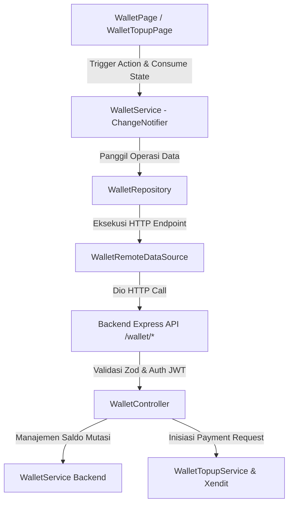
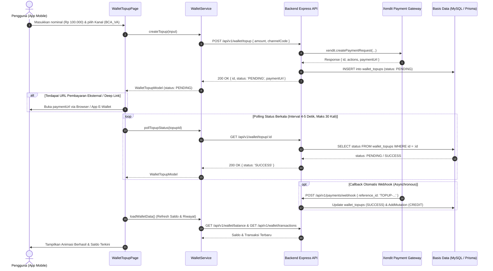

# Perencanaan Arsitektur & Integrasi API - Modul Dompet Digital / Saldo Dompet (Customer & Mitra) v1

Dokumen ini mendefinisikan spesifikasi kontrak API (Backend DTO), audit kesenjangan (*gap analysis*), desain struktur data frontend, arsitektur *caching* & *polling*, serta panduan integrasi modul Dompet Digital (*Wallet & Top-up*) antara **Backend (Express + Prisma + Zod + Xendit)** dan **Frontend Mobile (Flutter `travelindo`)**.

Acuan file backend:
- Route: [`Backend/src/routes/wallet.ts`](file:///d:/Retal-Apps/Backend/src/routes/wallet.ts)
- Controller: [`Backend/src/controllers/wallet.controller.ts`](file:///d:/Retal-Apps/Backend/src/controllers/wallet.controller.ts)
- Service Core Wallet: [`Backend/src/services/wallet.service.ts`](file:///d:/Retal-Apps/Backend/src/services/wallet.service.ts)
- Service Top-up & Webhook: [`Backend/src/services/wallet-topup.service.ts`](file:///d:/Retal-Apps/Backend/src/services/wallet-topup.service.ts)
- Validasi Zod: [`Backend/src/validations/wallet.validation.ts`](file:///d:/Retal-Apps/Backend/src/validations/wallet.validation.ts)

File panduan eksekusi task: [`travelindo/docs/TASK_WALLET_V1.md`](file:///d:/Retal-Apps/travelindo/docs/TASK_WALLET_V1.md)

---

## 1. Ringkasan Eksekutif & Batasan Ruang Lingkup (Scope Boundaries)

Modul Dompet Digital (*In-App Wallet*) adalah pusat sirkulasi finansial di dalam ekosistem Travelindo yang melayani dua kelompok pengguna:
1. **Bagi Pelanggan (*Customer*)**:
   - Menampung saldo pengembalian dana (*refund*) dari pembatalan sewa/tiket travel.
   - Sarana pembayaran instan untuk *instant booking* tanpa perlu membuka aplikasi perbankan berulang kali.
   - Pengisian saldo (*top-up*) mandiri melalui berbagai kanal pembayaran resmi (Virtual Account, E-Wallet, QRIS) yang terintegrasi dengan Payment Gateway (Xendit).
2. **Bagi Mitra (*Partner / Driver*)**:
   - Menampung pendapatan hasil transaksi sewa kendaraan dan tiket perjalanan travel (`totalEarned`).
   - Mencatat penarikan dana ke rekening bank pribadi (`totalWithdrawn`).
   - Memantau mutasi saldo secara *realtime* dengan catatan saldo sebelum (*balanceBefore*) dan saldo sesudah (*balanceAfter*).

### Batasan Ruang Lingkup Integrasi Mobile Client

Route yang diintegrasikan secara ketat difokuskan pada fungsionalitas pengguna akhir (*end-user*) terautentikasi:
- **DALAM RUANG LINGKUP (INCLUDED - MOBILE CLIENT)**:
  1. `GET /api/v1/wallet/balance` (Ambil informasi saldo aktif, total pendapatan, dan total penarikan akun pengguna).
  2. `GET /api/v1/wallet/transactions` (Ambil daftar riwayat mutasi kredit/debit dompet terpaginasi).
  3. `POST /api/v1/wallet/topup` (Inisiasi pengisian saldo dompet menggunakan kanal pembayaran Xendit).
  4. `GET /api/v1/wallet/topup/:id` (Pengecekan status berkala / *polling* transaksi top-up hingga terminal state `SUCCESS`/`FAILED`).
- **DILUAR RUANG LINGKUP MOBILE (EXCLUDED - BACKEND / WEBHOOK ONLY)**:
  - `POST /api/v1/payments/webhook`: Webhook endpoint dari Xendit dieksekusi secara asynchronous di tingkat server untuk memperbarui database dan menambah saldo pengguna secara atomik. Mobile apps hanya memanfaatkan mekanisme *polling* / Push Notification / FCM untuk menerima update.

---

## 2. Audit Kesenjangan (Gap Analysis) Backend vs Frontend Saat Ini

Berdasarkan investigasi menyeluruh pada kode Backend Express ([`Backend/src/routes/wallet.ts`](file:///d:/Retal-Apps/Backend/src/routes/wallet.ts), [`Backend/src/controllers/wallet.controller.ts`](file:///d:/Retal-Apps/Backend/src/controllers/wallet.controller.ts), [`Backend/src/services/wallet.service.ts`](file:///d:/Retal-Apps/Backend/src/services/wallet.service.ts), [`Backend/src/services/wallet-topup.service.ts`](file:///d:/Retal-Apps/Backend/src/services/wallet-topup.service.ts)) dan implementasi frontend Flutter (`travelindo/lib/features/wallet/`), ditemukan sejumlah kesenjangan kritis:

| No | Komponen / Area | Kondisi Backend (`Backend/src/routes/wallet.ts`) | Kondisi Frontend Saat Ini (`travelindo`) | Dampak Fatal / Risiko Teknis |
| :--- | :--- | :--- | :--- | :--- |
| **1** | **Parsing Response Saldo (`GET /wallet/balance`)** | Backend mengembalikan objek envelope berisi 4 atribut: `{ balance: Decimal, totalEarned: Decimal, totalWithdrawn: Decimal, updatedAt: DateTime }`. | `WalletRemoteDataSource.getBalance()` mengharapkan `double` dengan parsing: `(json as num?)?.toDouble() ?? 0.0`. | **Saldo SELALU BERNILAI `0.0` atau crash TypeCastException** karena `json` adalah sebuah `Map<String, dynamic>`, bukan angka primitif. Pengguna tidak bisa melihat saldo dompet mereka. |
| **2** | **Ketiadaan Konstanta URL di `ApiEndpoints`** | Endpoint top-up adalah `POST /wallet/topup` dan `GET /wallet/topup/:id`. | `travelindo/lib/core/network/api_endpoints.dart` **TIDAK memiliki** konstanta `walletTopup` maupun helper method `walletTopupStatus(id)`. | Kode di `WalletRemoteDataSource` yang memanggil `ApiEndpoints.walletTopup` akan memicu kompilasi error (*undefined getter*). |
| **3** | **Data Modeling Transaksi (`TransactionModel`)** | Backend mengembalikan: `id`, `type` (`CREDIT`, `DEBIT`, `TOPUP`, `EARNING`, `REFUND`, `WITHDRAWAL`, `PAYMENT`), `category` (`BOOKING`, `WALLET`, `SYSTEM`, `EARNING`, `WITHDRAWAL`, `REFUND`), `amount`, `balanceBefore`, `balanceAfter`, `description`, `createdAt`. **Tidak ada field `status`**. | `TransactionModel` memiliki field `status` (selalu kosong), dan **tidak memiliki field** `category`, `balanceBefore`, serta `balanceAfter`. | Data audit finansial terbuang, UI tidak bisa menampilkan saldo sebelum/sesudah transaksi, dan icon/kategori mutasi tidak akurat. |
| **4** | **Paginasi Riwayat Transaksi (`GET /wallet/transactions`)** | Backend menyediakan parameter query `page` dan `limit`, serta mengembalikan envelope `paginatedResponse` dengan `meta`, `data`, dan `pagination` (`page`, `limit`, `total`, `totalPages`). | `WalletRemoteDataSource.getTransactions()` tidak menerima parameter `page` maupun `limit`, dan mem-parsing data langsung sebagai list biasa tanpa metadata pagination. | Aplikasi hanya dapat mengambil 10 transaksi pertama selamanya. Tidak ada dukungan *infinite scroll* / *load more*. |
| **5** | **Ketiadaan Model Bertipe untuk Top-up (`WalletTopupModel`)** | Response `POST /wallet/topup` dan `GET /wallet/topup/:id` mengembalikan objek terstruktur: `{ id, amount, status, channelCode, paymentUrl, createdAt }`. | `WalletRemoteDataSource`, `WalletRepository`, dan `WalletService` menggunakan `Map<String, dynamic>` mentah. | Kehilangan keamanan tipe (*not type-safe*), rawan salah pengecekan string status, dan menyulitkan pemeliharaan kode. |
| **6** | **Validasi Nominal Top-Up** | Zod Backend (`createTopupSchema`) menetapkan `min: 10000` dan `max: 10000000`. Selain itu `wallet-topup.service.ts` mengecek batas channel `minAmount` dan `maxAmount`. | `WalletTopupPage` hanya memvalidasi `amount < 10000`, tanpa memeriksa batas atas Rp 10.000.000 maupun limit spesifik kanal pembayaran. | Request berpotensi ditolak server dengan `400 Bad Request` tanpa validasi responsif di sisi klien. |
| **7** | **Parameter Opsional Kanal Pembayaran (`channelProperties`)** | Backend menerima `channelProperties` opsional untuk kanal tertentu (misal nomor HP untuk `ID_OVO` atau URL pengembalian). | Frontend tidak menyediakan opsi input `channelProperties` pada antarmuka top-up. | Pembayaran via kanal tertentu yang mensyaratkan nomor telepon/akun tidak dapat diproses oleh gateway Xendit. |
| **8** | **Mekanisme Polling Top-Up yang Rapuh** | Status top-up pada Prisma enum adalah: `PENDING`, `SUCCESS`, `FAILED`, `EXPIRED`, `CANCELLED`, `REFUNDED`. | `WalletTopupPage` menjalankan `Timer.periodic` setiap 5 detik tanpa *timeout* / batas maksimal percobaan, dan hanya mengecek string `'SUCCESS'`. | Jika transaksi `FAILED` atau `EXPIRED`, polling akan berjalan tanpa henti (*memory leak & network waste*), menguras baterai ponsel pengguna. |
| **9** | **UI/UX Tampilan Saldo & Filter Transaksi** | Pengguna memerlukan rincian saldo masuk (*totalEarned* untuk mitra), saldo keluar (*totalWithdrawn*), tombol aksi cepat (Top Up, Tarik Dana, Pembayaran), serta filter riwayat transaksi (Semua, Masuk, Keluar). | `WalletPage` hanya memiliki card saldo sederhana dan satu listview transaksi tanpa segmentasi tab dan tanpa indikator status yang jelas. | Pengalaman pengguna terasa minim untuk aplikasi skala enterprise (*super-app travel & rental*). |

---

## 3. Spesifikasi Kontrak API Backend (Ground Truth)

Base URL: `{{AppEnv.apiV1BaseUrl}}` (misal: `http://10.0.2.2:3000/api/v1` di Android Emulator, `http://localhost:3000/api/v1` di iOS Simulator, atau URL server staging/produksi).

Format dasar envelope respons backend:
```json
{
  "meta": {
    "success": true,
    "status": 200,
    "message": "Pesan deskriptif"
  },
  "data": ...
}
```

---

### 3.1. Dapatkan Saldo Dompet (`GET /wallet/balance`)

Mengambil ringkasan saldo dompet pengguna yang sedang terautentikasi. Jika entitas wallet belum ada di database, backend otomatis membuatkannya dengan saldo 0 via `getOrCreateWallet(userId)`.

- **Endpoint**: `GET /wallet/balance`
- **Auth**: Bearer Token (`requireAuth`)
- **Headers**:
  ```http
  Authorization: Bearer <JWT_ACCESS_TOKEN>
  Accept: application/json
  ```
- **Response Success (`200 OK`)**:
  ```json
  {
    "meta": {
      "success": true,
      "status": 200,
      "message": "Saldo dompet berhasil diambil"
    },
    "data": {
      "balance": 250000.00,
      "totalEarned": 750000.00,
      "totalWithdrawn": 500000.00,
      "updatedAt": "2026-09-30T10:15:30.000Z"
    }
  }
  ```
- **Kemungkinan Error**:
  - `401 Unauthorized`: Token JWT tidak valid atau sesi berakhir.
  - `500 Internal Server Error`: Kegagalan koneksi database.

---

### 3.2. Dapatkan Riwayat Transaksi Dompet (`GET /wallet/transactions`)

Mengambil daftar mutasi saldo (kredit dan debit) akun pengguna secara terpaginasi berurutan dari yang paling baru (`orderBy: { createdAt: 'desc' }`).

- **Endpoint**: `GET /wallet/transactions`
- **Auth**: Bearer Token (`requireAuth`)
- **Headers**:
  ```http
  Authorization: Bearer <JWT_ACCESS_TOKEN>
  Accept: application/json
  ```
- **Query Parameters**:
  - `page` (opsional, integer, default: `1`): Nomor halaman.
  - `limit` (opsional, integer, default: `10`): Jumlah data per halaman.
- **Response Success (`200 OK`)**:
  ```json
  {
    "meta": {
      "success": true,
      "status": 200,
      "message": "Riwayat transaksi berhasil diambil"
    },
    "data": [
      {
        "id": "e458e617-bbd3-4927-9945-812e964f43a1",
        "type": "TOPUP",
        "category": "SYSTEM",
        "amount": 100000,
        "balanceBefore": 150000,
        "balanceAfter": 250000,
        "description": "Top-up saldo dompet",
        "createdAt": "2026-09-30T09:30:00.000Z"
      },
      {
        "id": "7b1341c2-612a-4bc4-9d58-450f75723b72",
        "type": "PAYMENT",
        "category": "BOOKING",
        "amount": 50000,
        "balanceBefore": 200000,
        "balanceAfter": 150000,
        "description": "Pembayaran sewa motor Yamaha NMAX",
        "createdAt": "2026-09-29T14:20:00.000Z"
      },
      {
        "id": "9a38f712-1d54-46f0-b98a-5e26399ecf33",
        "type": "EARNING",
        "category": "EARNING",
        "amount": 200000,
        "balanceBefore": 0,
        "balanceAfter": 200000,
        "description": "Pendapatan sewa kendaraan Honda Beat",
        "createdAt": "2026-09-28T08:15:00.000Z"
      }
    ],
    "pagination": {
      "page": 1,
      "limit": 10,
      "total": 3,
      "totalPages": 1
    }
  }
  ```

#### Referensi Enum Backend untuk Transaksi:
- **`TransactionType`**:
  - `CREDIT` / `TOPUP` / `EARNING` / `REFUND` -> Mutasi Masuk (Tanda `+`, Warna Hijau/Success).
  - `DEBIT` / `WITHDRAWAL` / `PAYMENT` -> Mutasi Keluar (Tanda `-`, Warna Merah/Critical).
- **`TransactionCategory`**:
  - `BOOKING`: Pembayaran transaksi sewa atau tiket travel.
  - `WALLET`: Mutasi internal dompet.
  - `SYSTEM`: Mutasi otomatis oleh sistem Travelindo (misal promo/koreksi).
  - `EARNING`: Pencatatan pendapatan mitra.
  - `WITHDRAWAL`: Penarikan dana dompet ke rekening bank.
  - `REFUND`: Pengembalian saldo akibat pembatalan pesanan.

---

### 3.3. Buat Permintaan Top-Up Saldo (`POST /wallet/topup`)

Menginisiasi transaksi pengisian saldo dompet menggunakan Payment Gateway Xendit. Backend memverifikasi batas minimum & maksimum nominal, memeriksa status aktif kanal pembayaran di tabel `PaymentChannel`, dan menghasilkan URL pembayaran (`paymentUrl`) serta daftar aksi interaktif (`actions`).

- **Endpoint**: `POST /wallet/topup`
- **Auth**: Bearer Token (`requireAuth`)
- **Headers**:
  ```http
  Authorization: Bearer <JWT_ACCESS_TOKEN>
  Content-Type: application/json
  Accept: application/json
  ```
- **Validasi Zod Backend (`createTopupSchema`)**:
  - `amount`: Wajib angka, minimal `10000`, maksimal `10000000`.
  - `channelCode`: Wajib string minimal 1 karakter (harus cocok dengan kode kanal pembayaran aktif, misal `BCA_VA`, `BNI_VA`, `ID_OVO`, `ID_DANA`, `ID_LINKAJA`, `QRIS`).
  - `channelProperties`: Opsional objek `Record<string, unknown>` (contoh: `{ "mobile_number": "081234567890" }` untuk OVO).
- **Request Body (`application/json`)**:
  ```json
  {
    "amount": 100000,
    "channelCode": "BCA_VA",
    "channelProperties": {}
  }
  ```
- **Response Success (`200 OK`)**:
  ```json
  {
    "meta": {
      "success": true,
      "status": 200,
      "message": "Top-up berhasil dibuat"
    },
    "data": {
      "id": "c1f7b049-7435-4ae2-a27e-cf972c3d5968",
      "amount": 100000,
      "status": "PENDING",
      "channelCode": "BCA_VA",
      "paymentUrl": "https://checkout.xendit.co/v2/...",
      "createdAt": "2026-09-30T10:30:00.000Z"
    }
  }
  ```
- **Kemungkinan Error**:
  - `400 Bad Request`:
    - `"Nominal top-up harus antara Rp 10.000 dan Rp 10.000.000"`
    - `"Metode pembayaran tidak tersedia"`
    - `"Nominal top-up di bawah batas minimum channel ..."`
    - `"Nominal top-up melebihi batas maksimum channel ..."`
  - `401 Unauthorized`: Token tidak valid.

---

### 3.4. Cek Status Top-Up (`GET /wallet/topup/:id`)

Memeriksa status terkini pesanan top-up berdasarkan UUID top-up. Digunakan oleh mobile client untuk melakukan polling saat menunggu pembayaran selesai.

- **Endpoint**: `GET /wallet/topup/:id`
- **Auth**: Bearer Token (`requireAuth`)
- **Headers**:
  ```http
  Authorization: Bearer <JWT_ACCESS_TOKEN>
  Accept: application/json
  ```
- **URL Params**:
  - `id`: UUID dari entitas `WalletTopup`.
- **Response Success (`200 OK`)**:
  ```json
  {
    "meta": {
      "success": true,
      "status": 200,
      "message": "Status top-up"
    },
    "data": {
      "id": "c1f7b049-7435-4ae2-a27e-cf972c3d5968",
      "amount": 100000,
      "status": "SUCCESS",
      "channelCode": "BCA_VA",
      "paymentUrl": "https://checkout.xendit.co/v2/...",
      "createdAt": "2026-09-30T10:30:00.000Z"
    }
  }
  ```
- **Nilai Enum `status`**:
  - `PENDING`: Menunggu pembayaran dari pengguna.
  - `SUCCESS`: Pembayaran berhasil diverifikasi, saldo telah bertambah.
  - `FAILED`: Pembayaran gagal ditagihkan oleh gateway.
  - `EXPIRED`: Batas waktu pembayaran habis.
  - `CANCELLED`: Dibatalkan oleh sistem atau pengguna.

---

## 4. Desain DTO & Data Modeling Flutter

Untuk memastikan *type safety* menyeluruh, dibuat model DTO terstruktur di `travelindo/lib/features/wallet/data/models/`:

### 4.1. `WalletBalanceModel` (`wallet_balance_model.dart`)
Model untuk menampung data saldo akun pengguna secara lengkap:
```dart
class WalletBalanceModel {
  const WalletBalanceModel({
    required this.balance,
    required this.totalEarned,
    required this.totalWithdrawn,
    this.updatedAt,
  });

  final double balance;
  final double totalEarned;
  final double totalWithdrawn;
  final String? updatedAt;

  factory WalletBalanceModel.fromJson(Map<String, dynamic> json) {
    return WalletBalanceModel(
      balance: (json['balance'] as num?)?.toDouble() ?? 0.0,
      totalEarned: (json['totalEarned'] as num?)?.toDouble() ?? 0.0,
      totalWithdrawn: (json['totalWithdrawn'] as num?)?.toDouble() ?? 0.0,
      updatedAt: json['updatedAt']?.toString(),
    );
  }

  Map<String, dynamic> toJson() => {
    'balance': balance,
    'totalEarned': totalEarned,
    'totalWithdrawn': totalWithdrawn,
    if (updatedAt != null) 'updatedAt': updatedAt,
  };
}
```

---

### 4.2. Refactoring `TransactionModel` (`wallet_model.dart`)
Model transaksi mutasi dompet yang diselaraskan dengan Prisma schema & response DTO:
```dart
enum TransactionTypeEnum {
  credit,
  debit,
  topup,
  withdrawal,
  payment,
  earning,
  refund,
  unknown,
}

enum TransactionCategoryEnum {
  booking,
  wallet,
  system,
  earning,
  withdrawal,
  refund,
  unknown,
}

class TransactionModel {
  const TransactionModel({
    required this.id,
    required this.type,
    required this.category,
    required this.amount,
    required this.balanceBefore,
    required this.balanceAfter,
    required this.description,
    required this.createdAt,
    this.status = 'COMPLETED',
  });

  final String id;
  final String type; // TOPUP, PAYMENT, EARNING, WITHDRAWAL, CREDIT, DEBIT, REFUND
  final String category; // BOOKING, WALLET, SYSTEM, EARNING, WITHDRAWAL, REFUND
  final double amount;
  final double balanceBefore;
  final double balanceAfter;
  final String description;
  final String createdAt;
  final String status; // Backwards compatibility getter

  bool get isCredit =>
      type == 'CREDIT' || type == 'TOPUP' || type == 'EARNING' || type == 'REFUND';

  TransactionTypeEnum get typeEnum => switch (type.toUpperCase()) {
        'CREDIT' => TransactionTypeEnum.credit,
        'DEBIT' => TransactionTypeEnum.debit,
        'TOPUP' => TransactionTypeEnum.topup,
        'WITHDRAWAL' => TransactionTypeEnum.withdrawal,
        'PAYMENT' => TransactionTypeEnum.payment,
        'EARNING' => TransactionTypeEnum.earning,
        'REFUND' => TransactionTypeEnum.refund,
        _ => TransactionTypeEnum.unknown,
      };

  TransactionCategoryEnum get categoryEnum => switch (category.toUpperCase()) {
        'BOOKING' => TransactionCategoryEnum.booking,
        'WALLET' => TransactionCategoryEnum.wallet,
        'SYSTEM' => TransactionCategoryEnum.system,
        'EARNING' => TransactionCategoryEnum.earning,
        'WITHDRAWAL' => TransactionCategoryEnum.withdrawal,
        'REFUND' => TransactionCategoryEnum.refund,
        _ => TransactionCategoryEnum.unknown,
      };

  factory TransactionModel.fromJson(Map<String, dynamic> json) {
    return TransactionModel(
      id: json['id']?.toString() ?? '',
      type: json['type']?.toString() ?? '',
      category: json['category']?.toString() ?? '',
      amount: (json['amount'] as num?)?.toDouble() ?? 0.0,
      balanceBefore: (json['balanceBefore'] as num?)?.toDouble() ?? 0.0,
      balanceAfter: (json['balanceAfter'] as num?)?.toDouble() ?? 0.0,
      description: json['description']?.toString() ?? '',
      createdAt: json['createdAt']?.toString() ?? '',
      status: json['status']?.toString() ?? 'COMPLETED',
    );
  }

  Map<String, dynamic> toJson() => {
    'id': id,
    'type': type,
    'category': category,
    'amount': amount,
    'balanceBefore': balanceBefore,
    'balanceAfter': balanceAfter,
    'description': description,
    'createdAt': createdAt,
    'status': status,
  };
}
```

---

### 4.3. `WalletTopupModel` (`wallet_topup_model.dart`)
Model untuk menampung respons pembuatan dan pengecekan status top-up:
```dart
enum TopupStatusEnum { pending, success, failed, expired, cancelled, unknown }

class WalletTopupModel {
  const WalletTopupModel({
    required this.id,
    required this.amount,
    required this.status,
    this.channelCode,
    this.paymentUrl,
    this.createdAt,
  });

  final String id;
  final double amount;
  final String status;
  final String? channelCode;
  final String? paymentUrl;
  final String? createdAt;

  TopupStatusEnum get statusEnum => switch (status.toUpperCase()) {
        'PENDING' => TopupStatusEnum.pending,
        'SUCCESS' => TopupStatusEnum.success,
        'FAILED' => TopupStatusEnum.failed,
        'EXPIRED' => TopupStatusEnum.expired,
        'CANCELLED' => TopupStatusEnum.cancelled,
        _ => TopupStatusEnum.unknown,
      };

  bool get isPending => statusEnum == TopupStatusEnum.pending;
  bool get isSuccess => statusEnum == TopupStatusEnum.success;
  bool get isTerminal =>
      statusEnum == TopupStatusEnum.success ||
      statusEnum == TopupStatusEnum.failed ||
      statusEnum == TopupStatusEnum.expired ||
      statusEnum == TopupStatusEnum.cancelled;

  factory WalletTopupModel.fromJson(Map<String, dynamic> json) {
    return WalletTopupModel(
      id: json['id']?.toString() ?? '',
      amount: (json['amount'] as num?)?.toDouble() ?? 0.0,
      status: json['status']?.toString() ?? 'PENDING',
      channelCode: json['channelCode']?.toString(),
      paymentUrl: json['paymentUrl']?.toString(),
      createdAt: json['createdAt']?.toString(),
    );
  }

  Map<String, dynamic> toJson() => {
    'id': id,
    'amount': amount,
    'status': status,
    if (channelCode != null) 'channelCode': channelCode,
    if (paymentUrl != null) 'paymentUrl': paymentUrl,
    if (createdAt != null) 'createdAt': createdAt,
  };
}
```

---

### 4.4. `CreateTopupInput` DTO (`create_topup_input.dart`)
Objek parameter untuk mencegah kesalahan struktur payload request:
```dart
class CreateTopupInput {
  const CreateTopupInput({
    required this.amount,
    required this.channelCode,
    this.channelProperties,
  });

  final double amount;
  final String channelCode;
  final Map<String, dynamic>? channelProperties;

  Map<String, dynamic> toJson() => {
    'amount': amount.toInt(),
    'channelCode': channelCode,
    if (channelProperties != null && channelProperties!.isNotEmpty)
      'channelProperties': channelProperties,
  };
}
```

---

## 5. Arsitektur Layering Flutter & Diagram Alur (Clean Architecture)

### 5.1. Struktur Layering Komponen


---

### 5.2. Sequence Diagram: Siklus Pengisian Saldo (Top-Up Flow)


---

## 6. Desain Antarmuka & Pengalaman Pengguna (UI/UX Guidelines)

Aplikasi `travelindo` mengedepankan estetika premium dengan sistem desain modern:

### 6.1. Halaman Utama Dompet (`WalletPage`)
1. **Header & Kartu Saldo Glassmorphic**:
   - Menampilkan total saldo aktif dengan tipografi besar nan tegas (`MoneyFormatter.formatRupiah`).
   - Tombol *Eye Toggle* untuk menyembunyikan/menampilkan saldo (privasi pengguna di tempat umum).
   - Indikator metrik mini di dalam kartu:
     - **Pemasukan**: Hijau muda (`+Rp ...`), merefleksikan akumulasi pendapatan (`totalEarned`).
     - **Penarikan**: Oranye/Merah (`-Rp ...`), merefleksikan akumulasi pencairan (`totalWithdrawn`).
2. **Aksi Cepat Finansial (*Quick Financial Actions*)**:
   - **Top Up** (Ikon `LucideIcons.circlePlus`): Membuka `WalletTopupPage`.
   - **Tarik Dana** (Ikon `LucideIcons.arrowUpRight`): Menuju `BankAccountListPage` / Halaman Pencairan.
   - **Riwayat Pembayaran** (Ikon `LucideIcons.receipt`): Menuju riwayat pembayaran sewa / booking.
3. **Filter & Segmentasi Riwayat Mutasi**:
   - Segmented Tab Chips: **Semua**, **Masuk (+)**, **Keluar (-)**.
   - Masing-masing item daftar transaksi menampilkan:
     - Ikon berlatar lingkaran berwarna sesuai jenis transaksi (`LucideIcons.arrowDownLeft` untuk kredit, `LucideIcons.arrowUpRight` untuk debit).
     - Judul deskripsi transaksi (misal: "Top-up saldo dompet", "Pembayaran sewa motor Yamaha NMAX").
     - Tanggal & jam transaksi diformat rapi (misal: "30 Sep 2026, 16:30").
     - Nominal dengan warna kontras (Hijau `+` atau Merah `-`).
     - Informasi saldo akhir (*balanceAfter*) untuk audit transparansi.
4. **Empty State & Infinite Scroll**:
   - Menampilkan `AppEmptyState` elegan dengan ikon `LucideIcons.walletCards` jika belum ada transaksi.
   - Mendukung tarikan penyegaran layar (*Pull-to-Refresh*) via `RefreshIndicator`.
   - Mendukung pemuatan halaman selanjutnya (*Load More*) saat user menggulir ke bawah daftar transaksi.

---

### 6.2. Halaman Pengisian Saldo (`WalletTopupPage`)
1. **Chip Pilihan Cepat Nominal**:
   - Pilihan instan: **Rp 20.000**, **Rp 50.000**, **Rp 100.000**, **Rp 200.000**, **Rp 500.000**, **Rp 1.000.000**.
   - Mengetuk chip otomatis mengisi TextField nominal dan mengupdate format Rupiah.
2. **Input Bebas dengan Format Realtime**:
   - `keyboardType: TextInputType.number`.
   - Prefix permanen `"Rp "` dengan pemisah ribuan otomatis (titik).
   - Validasi visual: Menampilkan teks merah jika di bawah Rp 10.000 atau di atas Rp 10.000.000.
3. **Pemilihan Kanal Pembayaran yang Terkategori**:
   - Mengambil daftar kanal dari `CustomerService.getPaymentChannels()` atau cache.
   - Mengelompokkan kanal ke dalam kategori:
     - **Virtual Account**: BCA, BNI, BRI, Mandiri, Permata.
     - **E-Wallet**: OVO, DANA, GoPay, ShopeePay, LinkAja.
     - **QRIS**: Instan via seluruh aplikasi perbankan/e-wallet.
4. **Input Properti Khusus Kanal (Contoh: Nomor HP OVO)**:
   - Jika pengguna memilih kanal `ID_OVO`, tampilkan TextField nomor ponsel akun OVO pengguna.
5. **Modal Lembar Status Polling (*Polling Sheet / Overlay*)**:
   - Saat transaksi top-up dibuat, tampilkan bottom sheet elegan yang memuat instruksi pembayaran, batas waktu hitung mundur (*countdown timer*), tombol "Buka Pembayaran", dan indikator *loading pulse*.
   - Timer polling dibatasi maksimal 3 menit (misal: tiap 4 detik, maks 45 kali).
   - Saat status berubah menjadi `SUCCESS`, tampilkan animasi centang hijau dan tombol "Selesai" yang langsung memperbarui saldo dompet di halaman utama.

---

## 7. Matriks Error Handling & Validasi

| Skenario Kasus | Kode HTTP | Pesan Respons Backend | Penanganan & Respons UX Frontend |
| :--- | :--- | :--- | :--- |
| **Nominal di Bawah Minimum** | `400 Bad Request` | `"Nominal top-up harus antara Rp 10.000 dan Rp 10.000.000"` | Validasi di form Flutter sebelum submit (tombol disable). Jika server menolak, tampilkan `SnackbarUtils.showError(context, message)`. |
| **Nominal di Luar Limit Kanal** | `400 Bad Request` | `"Nominal top-up di bawah batas minimum channel ..."` | Tampilkan pesan informatif sesuai channel yang dipilih. |
| **Kanal Pembayaran Tidak Aktif** | `400 Bad Request` | `"Metode pembayaran tidak tersedia"` | Refresh daftar kanal pembayaran dan minta pengguna memilih metode lain. |
| **Top-up Tidak Ditemukan** | `404 Not Found` | `"Top-up tidak ditemukan"` | Hentikan polling dan tampilkan notifikasi bahwa transaksi tidak valid. |
| **Sesi Token Kedaluwarsa** | `401 Unauthorized` | `"Token tidak valid atau kedaluwarsa"` | Interceptor Dio menangani refresh token otomatis atau alihkan ke alur login. |
| **Koneksi Jaringan Terputus** | `DioException` | Jaringan terputus / Timeout | Tampilkan Banner Offline / Snackbar: *"Koneksi terputus. Silakan periksa jaringan internet Anda."* |
| **Polling Timeout (Maks Percobaan Terlampaui)** | Client Timeout | Waktu polling habis | Hentikan timer polling. Berikan instruksi: *"Pembayaran Anda sedang diproses. Saldo akan otomatis bertambah setelah pembayaran diverifikasi."* |

---

## 8. Verifikasi & Checklist Acceptance Criteria

1. [ ] **Penambahan Endpoint di `ApiEndpoints`**:
   - `ApiEndpoints.walletTopup` (`/wallet/topup`) dan `ApiEndpoints.walletTopupStatus(id)` (`/wallet/topup/$id`) terdaftar dengan benar.
2. [ ] **Model Data Bertipe Lengkap**:
   - `WalletBalanceModel` mem-parsing `balance`, `totalEarned`, `totalWithdrawn`, dan `updatedAt` tanpa kesalahan tipe data.
   - `TransactionModel` mem-parsing `type`, `category`, `amount`, `balanceBefore`, `balanceAfter`, dan `description`.
   - `WalletTopupModel` dan `CreateTopupInput` mengelola transaksi top-up secara *strongly typed*.
3. [ ] **Perbaikan `WalletRemoteDataSource`**:
   - `getBalance()` mengembalikan `ApiResponse<WalletBalanceModel>`.
   - `getTransactions()` mendukung parameter paginasi `{int page = 1, int limit = 10}`.
   - `createTopup()` dan `getTopupStatus()` menggunakan DTO baru.
4. [ ] **Penyempurnaan `WalletService` (State Management)**:
   - State `WalletBalanceModel? _walletBalance` dikelola dengan baik, dengan helper getter `balance`, `totalEarned`, `totalWithdrawn`.
   - Manajemen riwayat transaksi mendukung paginasi dan filter.
   - Polling top-up memiliki batasan waktu (*timeout guard*) dan penanganan status terminal (`SUCCESS`, `FAILED`, `EXPIRED`, `CANCELLED`).
5. [ ] **Peningkatan UI `WalletPage` & `WalletTopupPage`**:
   - Kartu saldo menampilkan metrik pemasukan dan penarikan yang jelas.
   - Form top-up menyediakan chip nominal cepat, validasi batas nominal, pemilih kanal pembayaran, dan instruksi bayar.
   - Riwayat transaksi dapat difilter (Semua, Masuk, Keluar) dan menampilkan visual arah mutasi yang tegas.
6. [ ] **Integritas Analisis Statis**:
   - Lolos verifikasi `flutter analyze` tanpa warning atau error baru.
